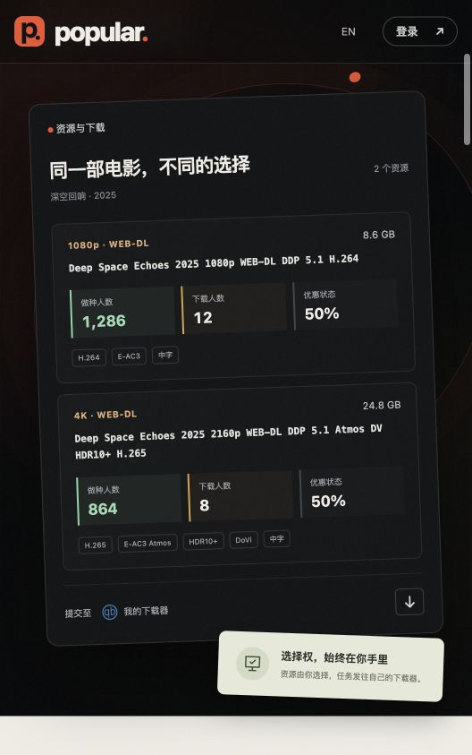
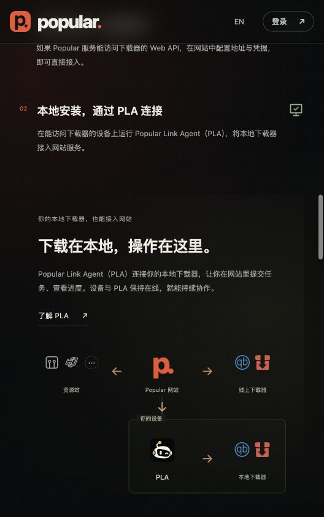
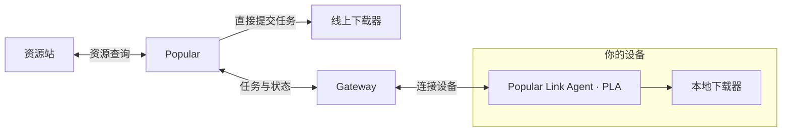

<p align="center">
  
</p>

<p align="center">
  <strong>连接你的资源站账号与下载器，在一个地方查找、比较资源并发起下载。</strong>
</p>

<p align="center">
  简体中文 · <a href="docs/README.en.md">English</a> · <a href="#开始使用">开始使用</a> · <a href="docs/development.md">开发指南</a> · <a href="https://github.com/yeast-io/Popular/issues">问题反馈</a>
</p>

---

## 为什么是 Popular？

想看一部电影，往往需要在不同资源站重复搜索、比较版本，再切到下载器提交任务，之后还要反复查看进度。

**Popular 把这些分散的操作连接起来。** 你继续使用自己的账号与设备，在统一的界面里完成资源选择与下载管理。

- **资源集中查找**：围绕电影与剧集，查看已连接站点的资源。
- **版本放在一起比较**：查看画质、编码、体积与标签，按需要筛选。
- **选择后直接提交**：发送到公网可访问的下载器，或经 PLA 接入的本地下载器。
- **进展主动通知**：发现可用资源、下载完成时，通过已绑定的消息渠道提醒你。
- **也可以从对话开始**：配置自己的 OpenAI API Key，通过智能助手获取推荐、查询资源并发起下载。

资源版本与目标下载器由你选择。Popular 不会替你自动挑选资源后直接下载。

## 界面预览

<table>
  <tr>
    <td width="50%" align="center"><strong>资源信息与版本比较</strong></td>
    <td width="50%" align="center"><strong>公网直连与本地设备接入</strong></td>
  </tr>
  <tr>
    <td align="center"></td>
    <td align="center"></td>
  </tr>
</table>

以上为首页的局部界面展示，资源内容为演示数据，不代表实际可下载的资源。

## 你可以用它做什么？

| 能力 | 使用方式 |
| --- | --- |
| 影视发现 | 浏览电影与剧集、搜索片名、查看详情与演职人员信息。 |
| 想看清单 | 收藏想看的电影与剧集，记录自己的观影安排。 |
| 观影偏好 | 标记喜欢或不喜欢，记录电影已看状态。 |
| 资源检索 | 连接已有资源站账号，查询资源、查看版本信息并筛选。 |
| 下载管理 | 选择目标下载器、提交任务，并查看由下载器同步的进度。 |
| 资源可用通知 | 将作品加入资源通知列表，检查发现可用资源后发送提醒。 |
| 下载完成通知 | 通过 Telegram 或 WhatsApp 接收下载完成消息。 |
| 智能助手 | 在可用的聊天渠道中获取推荐、查询资源、选择版本并提交下载。 |
| 双语体验 | 支持简体中文与 English。 |

资源可用提醒采用定期检查机制，默认检查间隔为 3 小时，可由部署配置调整，并非站点发布后的即时推送。

## 公网或本地，按你的方式连接



### 公网可访问，直接连接

如果 Popular 服务能够访问下载器的 Web API，在网站中配置地址和凭据，即可提交任务并查看进度。

### 本地安装，通过 PLA 连接

<p></p>

**Popular Link Agent（PLA）** 运行在能访问下载器的设备上，通过 Gateway 将本地下载器接入网站服务。

- **网站里选好，本地开始下载**：由 PLA 将任务交给本地下载器。
- **进展同步回来**：在 Popular 查看下载器返回的任务状态。
- **设置窗口关闭后继续运行**：设备与 PLA 保持在线，连接才能持续。
- **断开不停止已有下载**：已提交的下载继续运行，重新连接后恢复状态同步。

PLA 通过 Gateway 地址与 API Key 绑定设备，再连接本地下载器。你可以在网站的 `/link-agent` 页面查看图文介绍；构建与配置见 [PLA 指南](apps/helpers/agent/README.md) 和 [Gateway 指南](apps/helpers/gateway/README.md)。

## 当前集成

| 类型 | 当前支持 |
| --- | --- |
| 影视元数据 | TMDB |
| 资源站 | M-Team、HDArea |
| 下载器 | qBittorrent、Transmission |
| 消息通知与聊天渠道 | Telegram、WhatsApp |
| 智能助手 | 用户自行配置的 OpenAI API Key 与模型 |
| 本地设备连接 | Popular Link Agent（PLA）+ Gateway |

Discord 目前仅作为页脚社区入口占位，尚未作为聊天或通知集成。Telegram 社群入口也尚未配置，与 Telegram 消息功能是两回事。

## 开始使用

### 准备自己的工具

| 准备项 | 何时需要 |
| --- | --- |
| **OpenAI API Key** | 想使用智能助手时配置；手动查找资源和提交下载不需要。 |
| **资源站账号** | 资源查询需要自己已有的受支持站点账号与连接凭据。 |
| **下载器** | 自备受支持的下载器，公网直连或通过 PLA 接入。 |
| **消息通知工具** | 需要通知或聊天功能时，绑定 Telegram 或 WhatsApp。 |

浏览电影与剧集可以先从访客模式开始；个人清单与集成功能需要登录。

### 本地开发启动

先准备 Node.js、Corepack，以及可访问的 MongoDB、Redis、MinIO 和 TMDB 访问凭据。仓库使用 `package.json` 中指定的 pnpm 版本。

```bash
git clone https://github.com/yeast-io/Popular.git
cd Popular
corepack pnpm install --frozen-lockfile
cp .env.example .env
```

填写 `.env` 中的必需配置，并提前创建配置的 MinIO bucket，然后启动基础网站：

```bash
corepack pnpm --filter @movie-hub/contract build
corepack pnpm --parallel --filter @movie-hub/api --filter @movie-hub/web dev
```

打开 [http://localhost:5173](http://localhost:5173)。以上命令不启动 PLA 或 Gateway；本地下载器链路按各自指南单独配置。

完整环境配置、消息渠道、诊断与验证命令见 [开发指南](docs/development.md)。

## 技术组成

| 层次 | 技术 |
| --- | --- |
| Web | Vue 3、Vite、TypeScript |
| API | Fastify、TypeScript、TypeBox / Zod |
| 持久化与缓存 | MongoDB / Mongoose、Redis |
| 对象存储 | MinIO |
| 智能助手工作流 | LangGraph、OpenAI SDK |
| 设备代理 | Tauri 2、Rust、Vue |
| 设备通信 | 独立 Gateway、WebSocket |

## 文档与反馈

- [开发与本地运行](docs/development.md)
- [智能助手设计](docs/AI_ASSISTANT.md)
- [PLA 构建与配置](apps/helpers/agent/README.md)
- [Gateway 运行与协议](apps/helpers/gateway/README.md)
- [提交问题或功能建议](https://github.com/yeast-io/Popular/issues)

提交问题时，请提供复现步骤、应用版本和经过脱敏的错误信息，不要附上账号凭据、Cookie、API Key 或包含密钥的资源链接。

## 使用范围与许可

Popular 是影视发现、资源检索与下载管理工具，不提供影视正片在线播放，也不存储或托管影视正片文件。资源站账号、下载器与相关服务由用户自行准备；请遵守第三方平台规则，并确保拥有所下载内容的使用权限。

项目持续开发中。集成可用性取决于当前源码、部署配置与第三方服务；本文描述当前工作区中的实现，不承诺已发布对应安装包。

代码使用 [MIT License](LICENSE)。第三方 Logo、商标与影视元数据的权利归各自所有者。
