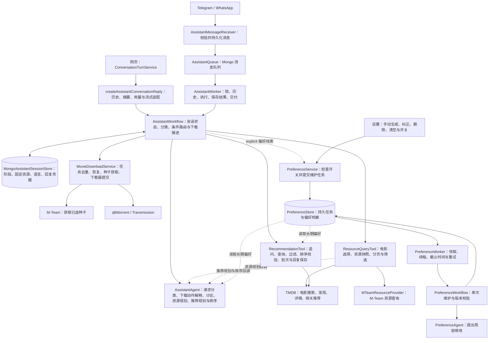
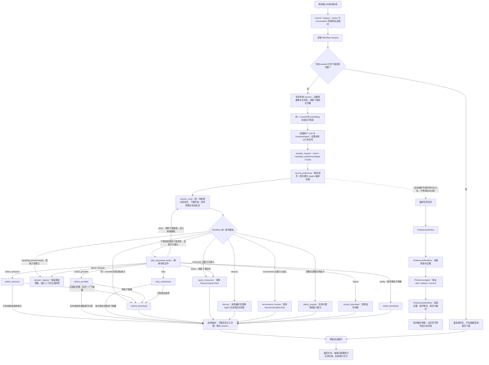

# AI Assistant

本文描述当前代码中的 Assistant、推荐、资源查询、下载和偏好维护流程。流程图区分组件调用关系与实际 Workflow 节点；

* 下面列出的限制是当前行为，不代表已经实现的改进。

## 整体架构

网页、Telegram 和 WhatsApp 共用 `AssistantWorkflow`。网页通过 `ConversationTurnService` 和 `createAssistantConversationReply` 接入；

消息渠道通过 `AssistantMessageReceiver → AssistantQueue → AssistantWorker` 接入。网页讨论可返回 SSE 流，推荐、资源和下载返回完整文本结果。Telegram / WhatsApp 的推荐结果可附带电影海报。

网页入口与会话 API 受 `PAGE_AI_ASSISTANT_ENABLED` 和测试环境限制共同控制；此开关不影响消息渠道 Assistant 或后台偏好维护。配置规则见 [测试环境页面](PAGES.md)。当前 WhatsApp 接收器只接受 self-chat 文本。



这是组件图。所有主任务路由与能力调用由 `AssistantWorkflow` 控制：讨论节点读取偏好并调用 Agent，推荐节点调用 RecommendationTool，资源节点调用 ResourceQueryTool，下载节点管理阶段与提交。AssistantAgent 不再持有工具或偏好存储，也不提供统一 handler；它只负责模型分类、规划、排序和回复生成。`PreferenceAgent` 仍是独立的偏好模型调用组件，推荐规划与排序则使用统一的 `AssistantAgent`，不存在独立的推荐 Workflow 或推荐 Agent 类。

Workflow 返回结果，不负责消息发送。网页的消息保存和 SSE 交付属于会话服务；Telegram / WhatsApp 的结果保存、海报发送和文本回复属于 AssistantWorker。

Agent 将话题意图 `intent` 与处理方式 `handling`（直接回答、调用能力、澄清）分开判断。信息问题不会因为下载选择尚未结束而被强制送入操作流程，也不会清除待选资源。需要实时下载状态但没有查询能力时，进入回答节点，由 Agent 说明该限制。回答节点提供实际能力、当前选择阶段、历史下载回复与会话语言；历史状态不代表实时状态。现有下载提交、重试授权、幂等与检查点恢复校验保持有效。旧格式决策缺少 `handling` 时仍兼容原工具路由。

## Workflow 控制流程

对应实现：[assistant.workflow.ts](../apps/api/src/modules/assistant/assistant.workflow.ts)。图中的节点名与代码一致；校验、会话存储和结果保存位于 LangGraph 调用外部。



图中省略异常连线：非业务兜底错误向调用方抛出，最终尝试释放租约；清理失败记录错误，不覆盖原异常，也不因清理失败重跑已完成的副作用。分类失败不会降级为 `unclear`。恢复提交检查点的路径目前仍先创建 LLM 并执行分类和偏好节点，随后由统一的 resolve_route 识别恢复状态，跳过下载动作规划，直接使用固定选择提交。

### Workflow 路由与执行节点

`record_preference` 固定连接到 `resolve_route`，不再提前分流下载。`resolve_route` 是所有主任务的统一路由入口，只确定路径，不执行工具或生成回复：先检查同一消息的提交检查点，再检查下载阶段或新下载请求，最后处理普通分类及模糊会话。下载动作 `other` 清除待选状态后也回到此节点，且不再重新进入下载规划。路由日志统一包含最终 intent 和 `resumeSubmission`。

普通分类仅在 `unclear` 时检查资源与推荐的有效会话。没有待处理下载阶段时，明确的讨论、推荐和资源请求不检查旧资源／推荐会话，直接进入各自执行节点。

| 优先级／分类／会话情况 | 路由结果 |
|---|---|
| 同一 eventId 的 `submitting` 检查点，下载能力已接入 | `submit_download`，使用固定资源与下载器恢复，不重新规划 |
| 有下载阶段或新 `download` 请求，下载能力已接入且未退出下载 | `plan_download_action`，结合当前阶段解释消息 |
| 明确 `discuss` | `discuss`：Workflow 读取偏好，Agent 生成文本或讨论流 |
| 明确 `recommend`／`resources`，能力已接入 | `recommend_movies`／`query_resources`，由 Workflow 直接调用工具并处理失败 |
| `unclear` 且只有一个有效资源或推荐会话 | 续接唯一有效会话；结果 intent 更新为实际执行的能力 |
| `unclear` 且两个会话都有效 | `clarify_request`，询问继续资源查询还是推荐；不调用任何业务工具，不再固定资源优先 |
| 无有效会话且意图仍不明确 | `clarify_request`，返回当前语言的澄清提示 |
| 能力未接入 | `answer_request`，结合实际能力限制回答当前问题 |

下载动作 `other` 先清除待选下载状态，保留语言与回复凭据，再进入 `resolve_route`。若动作规划表示退出下载，但请求分类仍是 `download`，两次模型判断冲突，直接澄清，不重新进入下载规划，也不根据旧资源会话猜测新目标。

`discuss`、`recommend_movies` 和 `query_resources` 是独立图节点，模型 Agent 不调用工具、不读取偏好存储、不处理业务失败兜底。Tool 仍负责自身业务校验与内部推荐／资源会话，Workflow 负责跨能力路由和下载阶段；这里不宣称各 Tool 的内部状态都已迁入主图。

### 分类与偏好信号

`AssistantAgent.classifyRequest()` 使用一次结构化模型调用，输出主意图 `discuss | recommend | resources | download | unclear`、独立的 `preferenceSignal: none | explicit | uncertain` 和 `locale`。结构校验只约束字段，不保证语义判断正确。

`record_preference` 节点先解析本轮语言，再在 `explicit` 且偏好服务已接入时提交聊天证据。PreferenceService 继续校验 `autoMaintain`；关闭时不入队。入队失败记录诊断并继续当前回复；后台维护不阻塞推荐或讨论。临时条件可立即参与推荐，不必等待长期偏好更新。

## 下载对话与阶段

对应状态：[assistant-session.types.ts](../apps/api/src/modules/assistant/assistant-session.types.ts)。阶段保存于 MongoDB session，独立于单次调用的 LangGraph 状态；模型解释动作，Workflow 校验阶段并控制副作用。

| 当前阶段 | 用户消息示例 | Workflow 行为 |
|---|---|---|
| `idle` | 下载星际穿越 / Download Interstellar | 解析电影并复用资源查询；还需确定电影时进入 `await_movie`，已有选定电影时进入 `await_resource` |
| `await_movie` | 2014 年那部 / 电影候选序号 | 由资源计划选择电影或补充查询；此阶段拒绝直接把电影候选序号当作资源编号提交 |
| `await_resource` | 第 2 个 / download release 2 | 校验资源快照，固定真实电影 ID、来源、资源 ID 和标题；一个下载器直接提交，多个或未配置时进入 `await_provider` |
| `await_provider` | 用 Transmission / 下载器序号 | 重新读取已配置下载器，校验选择后提交固定资源，不重新解析原资源编号 |
| `submitting` | 重试 / retry | 已保存提交检查点；失败保留选择，明确重试时复用原资源与下载器，成功后重置为 `idle` |

下载流程示例：`下载星际穿越 → 资源列表 → 第 2 个 → 下载器列表 → 用 Transmission → 任务 ID、下载器、状态、进度`。也支持先普通查询资源，再明确说“下载第 2 个”。第一版不自动替用户选择版本；明确选择资源，并在需要时选择下载器后直接提交，不增加第二次确认。

`query_resources` 是普通资源查询与下载查资源共用的执行节点。普通资源请求仅返回查询结果，不修改下载阶段；下载动作 `query` 复用 ResourceQueryTool 进行电影查询、候选选择、详情、分页、刷新和筛选，清除原固定选择并保留下载目标，之后根据资源上下文进入等待电影或等待资源阶段。因此这些动作本身不会下载，也不会将旧编号自动映射为新列表中的资源。

`select_resource` 只从服务端当前未过期的资源快照解析编号。模型不能提供资源 ID、ownerId 或下载器地址。下载只支持 M-Team；无效编号、过期快照和其他来源不提交。没有配置下载器时保留已选资源，提示配置；选择下载器时重新校验配置，已删除的配置不可继续使用。

提交前保存 `stage=submitting`、固定资源、下载器和 `submissionEventId`，再调用 `MovieDownloadService.createForOwner()`。服务校验资源仍存在，领取或恢复现有任务，获取种子并提交到指定下载器。失败不自动切换下载器；已有任务绑定到其他下载器时由下载服务拒绝冲突。

“取消”只清除当前对话中的选择流程，不取消已经提交的种子任务。`status` 和 `answer` 动作进入 `answer_request`，根据历史信息和实际能力回答；真正不明确的下载动作才进入 `clarify_download`。**对话中查询实时进度、暂停或删除下载任务尚未实现**；提交回复中的进度只是当次服务返回的状态快照，后续查看使用网页下载列表。

## 资源查询

对应实现：[ResourceQueryTool](../apps/api/src/modules/resource-query/resource-query.tool.ts) 和 [MTeamResourceProvider](../apps/api/src/modules/resource-query/mteam-resource.provider.ts)。AssistantAgent 生成结构化查询计划，工具负责真实电影身份、资源来源、快照与输出校验。

| 项目 | 当前行为 |
|---|---|
| 电影匹配 | TMDB 搜索；仅唯一精确匹配且搜索结果不跨多页时自动确定电影，否则最多提供 5 个候选 |
| 资源来源 | 通过 provider 注册表查询；生产装配目前接入 M-Team，不把模型给出的地址当资源来源 |
| 筛选 | 支持来源和分辨率；字幕、编码、价格、大小上限等条件不能可靠验证时要求调整 |
| 分页与编号 | 每页 10 条；编号在当前完整排序／筛选快照中全局连续；详情和下载均使用该编号 |
| 有效期 | 交互上下文与原始资源快照各自检查 30 分钟；翻页不会延长原快照新鲜度；刷新重新查询 |

资源上下文保存电影候选、选定电影、筛选条件、完整资源列表、原始来源结果和最近 20 个事件回复。来源失败不会伪装成“没有资源”，也不会当作成功缓存复用；部分成功的快照可复用成功来源，但不会延长它们原来的新鲜度。资源展示不获取种子、不提交下载；种子获取发生在下载服务中。

## 推荐流程

对应实现：[RecommendationTool](../apps/api/src/modules/recommendations/recommendation.tool.ts)，限制集中在 [recommendation.policy.ts](../apps/api/src/modules/recommendations/recommendation.policy.ts)。用户请求或续问才触发推荐；未实现定时主动推送。没有长期档案也能请求推荐，不强制先标记 5 部电影。

推荐工具管理持久会话与业务规则，模型决策通过 `AssistantAgent.planRecommendation()` 和 `rankRecommendations()` 回调执行，使用本轮同一个用户 LLM。候选查询、过滤、排序后校验及批次保存属于工具。

1. 读取会话与偏好，重放已保存事件；待回答任务超过 30 分钟重置追问上下文，保留批次去重记录。
2. 生成计划，最多追问 3 次。计划 `recommendNow=true` 或达到追问上限时不再追问；“先推荐／立即推荐”由模型提示词要求映射为 `recommendNow`，程序不另做自然语言确定性匹配。
3. 通过参考电影或最近两部喜欢电影的相关推荐、最多两页 TMDB Discover 获取候选，去重并排除已看、不喜欢、最近三个批次和不符合类型条件的电影，最多补查 12 部详情，再检查时长与原始语言。
4. 让 AssistantAgent 从真实候选中排序；校验返回 ID，再次读取已看／不喜欢状态，按请求数量截取，保存结果和批次。

每次最多返回 5 部及理由和 TMDB 链接，允许不足数量或没有结果。不可验证的硬性限制被计划识别后不返回未经核实的推荐。参考片搜索当前使用首个搜索结果获取相关推荐，不能声称已完成与资源查询相同的严格电影消歧。实际自然语言提取和理由仍依赖模型，失败不伪装成成功推荐或无匹配结果。

会话按 ownerId 和 `channel:chatId` 隔离，网页为 `web:threadId`；租约防止并发覆盖。保存最近 50 个事件回复及海报元数据、最近 20 个推荐批次。工具自身截止时间为 180 秒，但通过 AssistantWorkflow 调用时，还受外层 120 秒取消信号约束；底层操作只有在检查或响应信号时才能及时停止。

## 偏好构建与维护

对应实现：[PreferenceService](../apps/api/src/modules/preferences/preference.service.ts)、[PreferenceWorkflow](../apps/api/src/modules/preferences/preference.workflow.ts)、[PreferenceAgent](../apps/api/src/modules/preferences/agents/preference.agent.ts) 和 [PreferenceWorker](../apps/api/src/modules/preferences/preference.worker.ts)。偏好维护独立于主消息 Workflow。

1. 设置页手动生成／重新分析要求至少 5 部不同电影有 `liked` 或 `disliked` 标记，保存评价快照并入队；最多取最近 15 部喜欢、15 部不喜欢和 5 部中立但已看／感兴趣的电影。
2. 聊天分类仅在明确长期偏好线索且自动维护开启时入队；电影标记变化不会自动调用模型或维护档案。临时要求、为别人选片和例子不作为长期偏好。
3. PreferenceWorker 领取任务并续租；PreferenceWorkflow 检查任务是否已应用，读取档案，手动任务补充资料，再由 PreferenceAgent 提出 `add / replace / remove` 修改。
4. 领域规则验证证据来源、明确与推测边界、撤回保护和手动保护条目，确认租约并通过版本检查保存档案，Worker 再标记完成。

资料补充在后台进行，最多补查 10 部缺失电影详情；已有资料复用缓存。证据保留评价状态、片名、类型、导演和最多 5 位主要演员，不包含完整简介、图片、评分统计或同步时间。证据不足时不能虚构导演或演员偏好。手动任务补充资料前检查评价 fingerprint，已变化则拒绝旧快照；版本冲突会使本次尝试失败，由任务重试重新读取。

任务租约 180 秒，每 30 秒续租，单次截止 150 秒，最多执行 3 次，重试延迟为 30 / 60 秒。已应用任务通过应用凭据避免重复修改档案。手动生成具有每用户唯一活动槽。失败不覆盖现有档案。

页面支持查看档案、来源和近期版本，以及手动纠正、删除、清空、开关自动维护。纠正后的条目明确且受保护；删除记录撤回来源。清空只清除当前档案并关闭自动维护，历史版本、任务证据和原聊天仍保留，不能描述为删除全部历史数据。聊天维护关闭后，后续请求仍可读取已有档案。

## 语言与输出

支持的 locale 为 `zh-CN` 和 `en-US`。请求分类同时识别本轮语言；纯编号、年份和下载器名称按提示词返回 `null`。Workflow 使用“本轮识别语言 → session 语言 → 配置默认语言”的顺序，存回 session；生产默认来自 `TMDB_LANGUAGE`。语言识别依赖模型，结构约束不保证它总能正确识别。

固定讨论分发提示、资源／推荐失败提示和下载文案集中在 [assistant.presentation.ts](../apps/api/src/modules/assistant/assistant.presentation.ts)，包含下载状态翻译。资源和推荐工具都接收 Workflow 解析的本轮 locale，用于模型规划、电影资料获取以及固定回复／展示，不修改共享工具实例的默认语言。同一下载事件重放原回复，不重新翻译或执行业务动作。普通讨论由模型按用户语言回答。

**尚未完全统一的路径：**PreferenceService 的后台资料补充仍使用配置语言。AssistantWorker 的模型／执行异常兜底回复仍是代码中的中文文本，且通用兜底声称没有执行资源或下载操作；若错误发生在副作用之后，这句话不能作为未执行操作的证明。这些是当前实现缺口，不能把本轮下载文案本地化描述为所有路径均已完成双语处理。

消息渠道普通短文本上限为 1,800 个 Unicode 字符；推荐附带电影元数据时保留完整推荐文本。资源和下载文本保留列表与详情，但超过 4,000 个 UTF-16 code units 会抛错。网页讨论返回流句柄后由会话层消费和完成保存，不能把 Workflow 返回流句柄当作完整流已成功交付。

## 持久化、并发与恢复

| 状态 | 存储与隔离 | 恢复边界 |
|---|---|---|
| Workflow session | `assistantworkflowsessions`；ownerId + `channel:chatId` 唯一；租约 240 秒；交互 30 分钟；TTL 24 小时 | 下载阶段、固定选择、语言、提交 eventId、最近 20 条下载回复凭据；不是通用 LangGraph checkpointer |
| 资源会话 | `assistantresourcequeries`；ownerId + conversation；TTL 24 小时 | 独立检查上下文／快照 30 分钟，保存最近 20 个事件回复，失效编号不能继续选择 |
| 推荐会话 | `recommendationtasks`；ownerId + conversation | 追问、历史、批次、最近 50 条回复；由 RecommendationTool 自己管理租约和保存 |
| 偏好 | `tasteprofiles`、`preferencejobs`；ownerId | 档案版本、证据、撤回记录、任务租约与已应用凭据 |
| 消息与交付 | AssistantQueue / ConversationStore 各自保存 | 消息渠道先保存生成结果再交付；海报逐条保存发送进度；网页由会话服务保存消息与摘要 |

Workflow 交互过期后重置阶段，保留仍处于物理保留期内的下载回复凭据；同一 eventId 的提交检查点可恢复固定选择。租约获取失败直接报忙；Workflow 的 240 秒租约不是跨用户共享锁，下载器任务也不由此锁替代。

提交恢复依赖 MovieDownloadService 的唯一资源任务领取、下载器绑定及标签／hash 查询。MongoDB 写入与远程下载器提交不是一个原子事务，不能保证严格 exactly-once。消息发送与交付进度保存之间也有崩溃窗口，海报或文本可能重复；回复重放能避免正常交付重试再次调用模型，但不能消除外部系统的所有重复窗口。

## 目录与职责

以下为相关实现文件，省略同目录的测试和非核心辅助文件；不要求各模块具有相同文件形状。

```text
apps/api/src/modules/
├── assistant/
│   ├── agents/assistant.agent.ts
│   ├── assistant.workflow.ts + assistant-workflow.types.ts
│   ├── assistant-session.types.ts + assistant-session.domain.ts + assistant.presentation.ts
│   ├── assistant.receiver.ts + assistant.worker.ts
│   ├── assistant.conversation.ts + assistant.typing.ts
│   └── assistant.types.ts + assistant.schema.ts + assistant-decision.schema.ts
├── recommendations/
│   ├── recommendation.tool.ts
│   ├── recommendation.policy.ts + recommendation.messages.ts
│   └── recommendation.types.ts + recommendation.domain.ts
├── resource-query/
│   ├── resource-query.tool.ts + resource-query.presentation.ts
│   ├── resource-query.types.ts + resource-query.domain.ts
│   └── mteam-resource.provider.ts
├── downloads/
│   └── movie-download.service.ts + movie-download.routes.ts + movie-download.types.ts
└── preferences/
    ├── agents/preference.agent.ts
    ├── preference.workflow.ts + preference.worker.ts
    ├── preference.service.ts + preference.routes.ts
    ├── preference.types.ts + preference.domain.ts
    └── preference-edit.schema.ts + preference-proposal.schema.ts
```

Agent 目录负责模型调用与结构化输出，ESLint 限制其导入存储和业务编排实现；AssistantAgent 不再注入能力接口，Workflow 直接调用工具，仅把 Agent 的规划／排序方法作为模型决策回调传给工具。Tool 负责真实业务数据、校验与会话结果，Workflow 控制跨阶段推进，Worker 控制后台调度和交付。`server.ts` 负责生产依赖装配。

MongoDB 实现位于 `infrastructure/mongodb/assistant/`、`preferences/`、`recommendations/` 和 `resource-query/`。公共模型上下文构建位于 `modules/llm/llm.context.ts`；系统提示词位于 `config/system-prompts/`。LLM 调用使用各用户配置的密钥和模型，不回退到共享系统密钥；`createForOwner` 只接受来自已验证渠道绑定或已认证会话的内部身份，HTTP 下载入口仍校验 session token。

Schema 和 Store 按职责分离：MongoDB 的 `assistant-session.schema.ts`、`resource-query.schema.ts` 定义字段、索引及模型工厂，对应 `.store.ts` 仅接收模型并执行持久化。Agent 的模型输出验证集中在 `assistant-decision.schema.ts`、`preference-proposal.schema.ts`，偏好编辑验证在 `preference-edit.schema.ts`。配置 Schema 与推导配置类型位于 `config/env.schema.ts`，`config/env.ts` 负责加载和错误报告。所有实现文件（包括 Queue、Worker、Service、基础设施、前端 TypeScript 与 Vue 脚本）的命名接口和类型别名均从相应 `.types.ts` 导入，文件内私有类型也遵守此约定。AssistantQueue、AssistantJob 和 AssistantConversation 定义在 `assistant.types.ts`，原 `assistant.queue.ts` 已移除。类型文件不包含运行时常量、函数或错误类；命名和依赖规则见项目根目录 `AGENTS.md`，ESLint 对混放进行检查。

## API

以下路径前缀均为 `/api/v1`。聊天通过 Workflow 调用内部能力，不通过模型提供 HTTP token。

| 方法与路径 | 作用 |
|---|---|
| `GET /conversations`、`POST /conversations` | 列出／创建网页会话 |
| `GET /conversations/:threadId/messages`、`POST /conversations/:threadId/messages` | 读取消息／追加用户消息；追加消息本身不等于执行 Assistant |
| `POST /conversations/:threadId/turns`、`POST /conversations/:threadId/turns/stream` | 执行网页 Assistant 回合，普通响应或 SSE |
| `GET /me/preferences` | 档案、长文本、评价数量、变化提示和任务状态 |
| `POST /me/preferences/generate`、`PATCH /me/preferences` | 202 入队分析／携带 `expectedVersion` 修改档案 |
| `GET /me/download-providers` | 列出用户已配置下载器；存在配置不等于已验证当前在线 |
| `POST /me/movies/:tmdbId/downloads` | 提交已选 M-Team 资源，可指定下载器 |
| `GET /me/movies/:tmdbId/downloads` | 查询并同步该电影下载任务 |

偏好 PATCH 的 `entryId + content` 表示纠正，只有 `entryId` 表示删除，`clear: true` 清空，`autoMaintain` 修改聊天维护开关；来源、身份和历史版本由服务端维护。多下载器未指定选择时下载服务返回选择错误，单下载器可自动选择；已有任务优先遵守原下载器绑定。

## 诊断与验证

Workflow、推荐／资源工具和下载入口使用 AiTrace / aiStep 传播 correlationId，记录阶段、耗时、任务 ID、尝试次数和结果。生产装配传入 `VERBOSE`；默认 `VERBOSE=false` 关闭相应阶段诊断，`VERBOSE=true` 开启并继续受 LOG_LEVEL 控制，错误不因关闭 verbose 被压制。日志复用诊断序列化与脱敏，不应输出密钥、凭据、用户原话、偏好正文或模型原始载荷；这项约定不表示所有历史入口均已完成一致性审计。

相关测试覆盖明确请求直达节点、单任务续接、双任务冲突澄清、偏好入队与主意图独立、工具错误日志与取消传播、请求分类、语言继承与切换、网页讨论流、推荐追问与候选校验、资源分页／快照过期、下载固定选择／多下载器／事件重放／提交检查点恢复，以及偏好证据保护、版本冲突和任务去重。主要入口为 `assistant.workflow.test.ts`、`assistant.routing.test.ts`、`assistant.download.test.ts`、Agent 测试、`resource-query.tool.test.ts`、`recommendation.tool.test.ts`、下载服务测试和各 Mongo store 测试。

本地替身测试不能证明真实模型语言与动作识别的准确率、手机交付、真实下载器行为或生产 MongoDB 结果。真实账号与下载器端到端验证仍需单独执行。文档中的恢复机制描述程序控制，不代表已验证外部系统严格一次执行。

常用检查：

```sh
pnpm check
pnpm --filter @movie-hub/api test
pnpm test
pnpm build
```

需要定位实现时，先检查 `server.ts` 的装配、`AssistantWorkflow` 的条件边和对应 Tool／Service，再查看调用方的持久化与交付；不要根据组件图推断不存在的状态节点。
