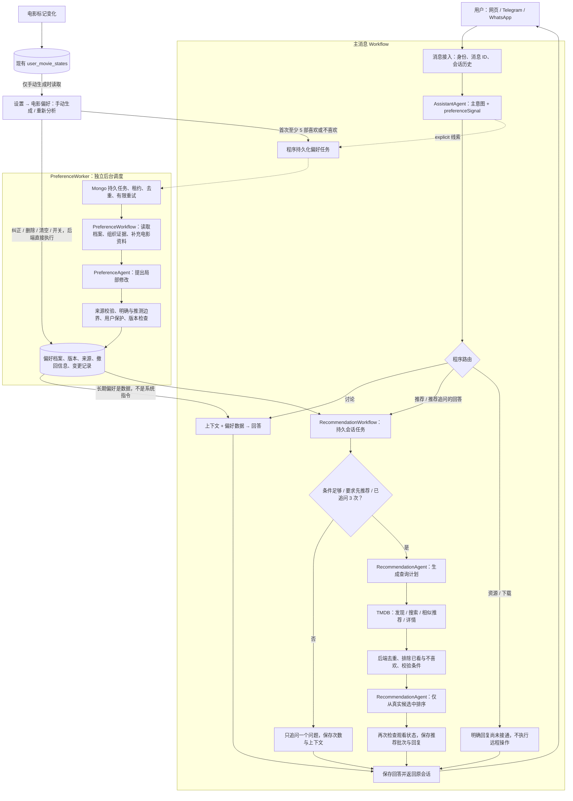

# AI Assistant

当前代码中的 AI Assistant 架构与首版偏好维护约定。

主消息 Workflow 与偏好维护 Workflow 独立运行。意图 Agent 只报告线索，程序决定是否持久化维护任务。维护失败不阻断本轮回答。

网页入口与会话 API 受 `PAGE_AI_ASSISTANT_ENABLED` 和测试环境限制共同控制；此开关不影响后台 Agent、Workflow、消息渠道 AI 或偏好生成。配置与 Docs 页面规则见 [测试环境页面](PAGES.md)。

网页普通讨论保持 SSE 流式输出；推荐会在工具查询与校验完成后返回完整结果。Telegram / WhatsApp 通过已有消息队列回复。

| 能力 | 使用或维护的数据 |
|---|---|
| 讨论 | 会话标识、近期消息、会话摘要 |
| 资源 | 远程查询尚未接通，当前返回明确占位回复 |
| 推荐 | 长期偏好版本、本次条件、候选电影、推荐批次 ID |
| 偏好维护 | 来源消息／电影记录、偏好条目、档案版本、变更记录 |
| 下载 | 远程操作尚未接通，不创建下载任务；待确认操作属于后续范围 |



需要注意三个边界：

1. **意图 Agent 发现线索，程序触发 Workflow。**偏好维护 Agent 才负责判断具体修改；没有有效新证据时不更新档案。
2. **本次要求直接进入业务 Agent。**“今天想看战争片”立即影响推荐，不必等待长期偏好更新。
3. **后台更新完成后，后续请求读取新版档案。**用户明确的硬性限制和已看排除仍须由后端执行，不能只依靠偏好文本。


## 目录与职责约定

三个模块统一使用以下结构；只创建实际需要的文件，不为对齐目录创建空实现。

```text
modules/
├── assistant/
│   ├── agents/assistant.agent.ts
│   ├── assistant.workflow.ts
│   ├── assistant.worker.ts
│   ├── assistant.types.ts + assistant.schema.ts
│   └── assistant.receiver.ts + assistant.queue.ts
├── preferences/
│   ├── agents/preference.agent.ts
│   ├── preference.workflow.ts + preference.worker.ts
│   ├── preference.types.ts + preference.domain.ts
│   └── preference.service.ts + preference.routes.ts
└── recommendations/
    ├── agents/recommendation.agent.ts
    ├── recommendation.workflow.ts
    └── recommendation.types.ts + recommendation.domain.ts
```

- `agents/`：模型调用与结构化输出。Agent 不直接访问 MongoDB，也不依赖 Service、Workflow 或 Worker；ESLint 检查这些导入边界。
- `*.workflow.ts`：业务编排。AssistantWorkflow 使用 LangGraph 的 `detect_intent → handle` 节点，负责路由、提交偏好任务及调用推荐；PreferenceWorkflow 执行单次维护；RecommendationWorkflow 管理追问、查询、过滤和推荐结果。
- `*.worker.ts`：后台消费和生命周期。PreferenceWorker 负责领取任务、续租、截止时间、重试与完成状态；AssistantWorker 负责已有消息队列消费和回复交付。推荐随请求执行，无独立 Worker。
- `*.types.ts` 放类型及业务存储接口，`*.schema.ts` 放运行时输入校验，`*.domain.ts` 放业务规则；测试与被测文件同目录，命名为 `*.test.ts`。共享模型上下文工具放在 `modules/llm/llm.context.ts`。
- MongoDB schema 与 store 分别放在 `infrastructure/mongodb/preferences/`、`infrastructure/mongodb/recommendations/`。Workflow 通过存储接口使用它们；模型名称、集合名称及原有索引保持不变，本次目录重构无需迁移数据。

## 偏好构建与维护

- 设置页面新增“电影偏好”分类。首次手动生成需要至少 5 部不同电影有 `liked` / `disliked` 标记；`watched` / `interested` 仅作为补充依据。已生成档案可在评价减少后重新分析。
- **电影标记变化不会自动调用模型或提交偏好维护任务。** 页面显示电影记录是否变化，由用户手动重新分析。点击生成只校验、快照证据并入队；TMDB 资料补充和模型分析都在后台执行。
- 分析样本最多包含最近 15 部喜欢、15 部不喜欢及 5 部中立但已看／感兴趣的电影；最多补查 10 部缺失详情，已有资料复用缓存。缺失资料不能作为虚构导演、演员偏好的依据。 模型证据只包含评价状态、片名、类型、导演和最多 5 位主要演员，不传完整简介、图片路径、评分统计及同步时间等目录字段，以控制上下文体积；仍保留全部已选样本及其来源引用。
- 聊天分类输出 `intent` 和独立的 `preferenceSignal: none | explicit | uncertain`。仅 `explicit` 且自动维护开启时提交任务。没有额外的每条消息偏好分类调用，不回扫全部历史聊天。
- 临时需求、为他人选片和例子不写入长期档案。电影反馈形成推测；用户明确长期表达形成明确条目。已看不代表喜欢，喜欢一部电影不等于喜欢其所有演员或导演。

系统提示词统一在 `apps/api/src/config/system-prompts/`，按职责分为 `default.prompts.ts`、`assistant.prompts.ts`、`preference.prompts.ts`、`recommendation.prompts.ts`、`conversation.prompts.ts`。偏好提示词有独立版本号。用户长期偏好、本次要求与近期对话仍在运行时作为数据传入；业务校验仍由 Workflow 执行。

`PreferenceAgent` 使用结构化输出提出 `add / replace / remove` 操作，不直接写数据库。`PreferenceWorkflow` 验证来源和目标条目，禁止电影证据写入明确偏好，禁止后台覆盖用户手动保护的条目。明确表达与推测分别存储，供推荐使用时生成一份长文本。档案并不替代现有电影标记。

## 用户控制与持久化

页面支持查看偏好、来源引用、最近历史版本，手动纠正、删除、清空和切换聊天自动维护。手动纠正转为明确且受保护的条目；后续自动任务不能覆盖，用户仍可再次编辑或删除。删除保留撤回来源，重新分析不能根据相同电影证据恢复条目；这是按来源采取的保守抑制，可能同时减少共享该证据的其他推断。清空仅清除当前档案并关闭自动维护，历史版本、任务证据和原聊天仍保留用于追溯，**不是删除全部历史数据**。

MongoDB 新增 `tasteprofiles`、`preferencejobs`、`recommendationtasks`。所有读写限定已认证 `ownerId`，模型不能选择身份。档案使用 compare-and-set 版本检查；任务保存应用凭据，恢复执行时已应用的任务不重复调用模型。手动生成任务有每用户唯一活动槽，防止连续点击或多实例重复生成。

`PreferenceWorker` 负责调度和任务状态转换，`PreferenceWorkflow` 只执行一次业务维护。维护任务租约为 180 秒，每 30 秒续租，单次执行截止为 150 秒；模型与元数据操作检查取消状态。最多执行 3 次，失败按次数延迟 30 / 60 秒再试。失败保留原档案。模型调用统一使用该用户的密钥和已选模型，计入 `preference.update` 使用统计。页面不会替用户配置系统共享密钥。

手动生成任务使用提交时的电影反馈快照。执行前发现反馈变化会拒绝使用过时快照，最终失败后可重新生成。并发版本冲突会重新读取最新档案并有限重试。

## 推荐流程

用户请求推荐才触发本轮推荐；未实现定时主动推送。没有长期画像也能试推荐，不强制先完成 5 部标记或生成档案。

同一推荐任务最多追问 **3 次**，条件足够则提前查询。识别“先推荐／立即推荐／直接推荐”等表达后，程序禁止继续追问，进入查询。新表达直接参与本次推荐，不必等待偏好保存完成。待回答任务超过 30 分钟重置追问上下文，历史推荐批次仍保留用于去重。

推荐会话状态按 `ownerId + channel + chatId` 隔离；网页使用 `web + threadId`。数据库租约防止同会话并发覆盖。每个事件保留最近 50 条回复记录，每个会话保留最近 20 个推荐批次，交付重试复用结果。

查询计划支持类型、排除类型、最长时长和原始语言，以及参考电影。候选来自 TMDB Discover 的最多两页、参考电影的相关推荐，或者最近两部喜欢电影的相关推荐。后端去重、排除已看和不喜欢、排除最近三个批次中推荐过的电影，最多补查 12 部候选详情。类型、时长和语言由后端校验；导演、主要演员和简介提供给排序模型作为真实依据。最终只能返回候选集合中存在的 ID，返回前再次读取已看／不喜欢状态。

最多返回 5 部电影及理由和 TMDB 详情链接，允许不足 5 部或没有结果。对“保证没有血腥”等无法由当前资料验证的硬性限制，计划应标记不可验证，Workflow 不返回未经核实的推荐。自然语言提取与理由仍依赖模型，结构校验不等于语义准确率保证。TMDB 查询失败返回查询失败，不伪装成没有资源或已成功推荐。

## API

| 方法与路径（前缀 `/api/v1`） | 作用 |
|---|---|
| `GET /me/preferences` | 当前档案、长文本、评价数量、变化提示、任务状态 |
| `POST /me/preferences/generate` | 生成或重新分析，返回 202；不会等待模型完成 |
| `PATCH /me/preferences` | 携带 `expectedVersion` 更新开关、纠正／删除条目或清空 |

PATCH 的 `entryId + content` 表示纠正；只有 `entryId` 表示删除；`clear: true` 清空；`autoMaintain` 控制聊天维护。来源、身份和历史版本由后端维护，不接受客户端覆盖。

## 验证与边界

覆盖初次生成门槛、观看与喜好分离、来源伪造、撤回保护、用户纠正、版本冲突、任务恢复去重、意图信号不阻断主回复、网页流式兼容、最多三次追问、立即推荐、真实候选校验与已看排除。页面测试覆盖手动生成、门槛、版本提交及删除确认。

本地测试使用模型与 TMDB 替身，不能证明真实模型判断准确率、真实平台网络可用性或生产数据库运行结果。首次上线仍需使用已配置账户检查生成状态并人工检查画像内容。

测试与构建：`pnpm test`、`pnpm typecheck`、`pnpm build`。当前 Node 的实验性 Web Storage 会干扰 happy-dom；前端测试可用 `NODE_OPTIONS=--no-experimental-webstorage pnpm --filter @movie-hub/web test`。

参考：[OpenAI Structured Outputs](https://developers.openai.com/api/docs/guides/structured-outputs)、[TMDB Discover Movie](https://developer.themoviedb.org/reference/discover-movie)。
