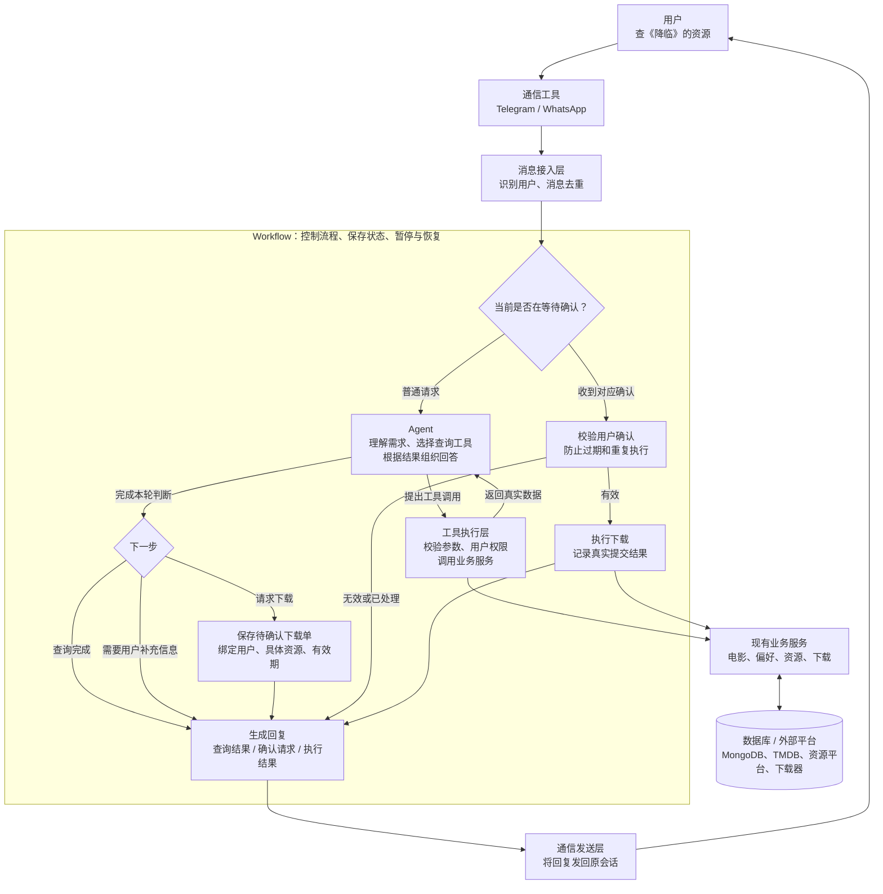

# AI Assistant

This is how the AI Assistant works

| 顺序 | 新能力 | 届时新增的数据 |
|---|---|---|
| 讨论 | 使用上下文生成回答 | 会话标识、选取的历史消息 |
| 资源 | 找到电影并查询资源 | 当前电影 ID、资源列表引用 |
| 推荐 | 读取偏好并生成候选 | 偏好、候选电影、推荐批次 ID |
| 下载 | 创建待确认操作并恢复执行 | 待确认操作 ID、确认结果 |

