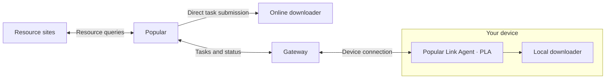

<p align="center"></p>
<h1 align="center">Popular</h1>
<p align="center"><strong>Multiple sources. Your own downloaders. One place to manage them.</strong></p>
<p align="center"><a href="../README.md">简体中文</a> · English · <a href="development.md">Development guide</a> · <a href="https://github.com/yeast-io/Popular/issues">Feedback</a></p>

## Why Popular?

Finding a movie can mean repeating searches across resource sites, comparing versions in separate tabs, sending a task to a downloader and checking back for progress.

**Popular connects that workflow.** Keep your own accounts and devices while finding releases, choosing a version and submitting downloads from one interface.

- Find releases from connected resource sites around a movie or TV show.
- Compare quality, encoding, size and tags before choosing.
- Submit to a reachable downloader directly, or connect a local downloader through PLA.
- Receive availability alerts and download completion messages through linked channels.
- Configure your own OpenAI API Key to start with a recommendation or a conversation.

You choose the release and target downloader. Popular does not automatically choose a release and start a download for you.

## Interface preview

<table>
  <tr><td width="50%" align="center"><strong>Compare releases</strong></td><td width="50%" align="center"><strong>Connect your downloaders</strong></td></tr>
  <tr><td align="center"></td><td align="center"></td></tr>
</table>

These screenshots show parts of the Chinese landing page. Release records are illustrative data, not a claim that those releases are available.

## Features

| Capability | What it does |
| --- | --- |
| Movie and TV discovery | Browse titles, search by name and view story, cast and show details. |
| Watch lists | Save movies and shows for later. |
| Viewing preferences | Mark likes and dislikes and track watched movies. |
| Resource search | Query connected sites, inspect versions and filter release information. |
| Download management | Choose a downloader, submit tasks and follow reported progress. |
| Availability notifications | Follow a title and receive a message when a periodic check finds an available release. |
| Completion notifications | Receive download completion messages through Telegram or WhatsApp. |
| AI assistant | Get recommendations, find releases, choose a version and submit a download in supported chat channels. |
| Localization | Simplified Chinese and English. |

Availability checks default to every three hours and can be configured by the deployment. They are not instant site publication events.

## Connect your way



### Reachable downloaders

If the Popular service can reach your downloader's Web API, configure its address and credentials on the website. Submit tasks and follow progress directly.

### Local downloaders with PLA


**Popular Link Agent (PLA)** runs on a device that can reach your downloader and connects it to Popular through a Gateway.

- Choose a release on the website; PLA submits it to your local downloader.
- Follow the task status reported by the downloader in Popular.
- Close the settings window while Agent continues in the background.
- Disconnecting Agent does not stop existing downloads; status syncing resumes after reconnection.

Keep the device and PLA online. Bind the device using its Gateway address and API Key, then configure the downloader in PLA.

The website includes an introduction at `/link-agent`. See the [PLA guide](../apps/helpers/agent/README.md) and [Gateway guide](../apps/helpers/gateway/README.md) for source builds and configuration.

## Current integrations

| Category | Supported integrations |
| --- | --- |
| Movie metadata | TMDB |
| Resource sites | M-Team, HDArea |
| Downloaders | qBittorrent, Transmission |
| Messaging and notifications | Telegram, WhatsApp |
| AI service | A user-configured OpenAI API Key and model |
| Local device connection | Popular Link Agent + Gateway |

Discord is currently a footer community placeholder, not a chat or notification integration. The Telegram community link is also a placeholder, separate from the implemented Telegram messaging integration.

## Before you start

| Bring your own | When it is needed |
| --- | --- |
| OpenAI API Key | Optional: required for the AI assistant, not for manual resource search and download submission. |
| Resource accounts | Your existing supported site accounts and connection credentials for resource search. |
| Downloader | A supported downloader, connected directly or through PLA. |
| Messaging tool | Link Telegram or WhatsApp for notifications or chat features. |

Visitors can browse movies and TV shows. Personal lists and integrations require an account.

## Run from source

Prepare Node.js, Corepack and reachable MongoDB, Redis and MinIO services, plus TMDB credentials. Use the pnpm version declared in the repository's `packageManager` field.

```bash
git clone https://github.com/yeast-io/Popular.git
cd Popular
corepack pnpm install --frozen-lockfile
cp .env.example .env
```

Fill in required environment variables and create the configured MinIO bucket before starting:

```bash
corepack pnpm --filter @movie-hub/contract build
corepack pnpm --parallel --filter @movie-hub/api --filter @movie-hub/web dev
```

Open [http://localhost:5173](http://localhost:5173). These commands start the API and web app, not PLA or Gateway. Configure those separately if you need local downloader connectivity.

See the [development guide](development.md) for configuration, diagnostics and validation commands.

## Technology

| Layer | Stack |
| --- | --- |
| Web | Vue 3, Vite, TypeScript |
| API | Fastify, TypeScript, TypeBox / Zod |
| Data and caching | MongoDB / Mongoose, Redis |
| Object storage | MinIO |
| Assistant workflows | LangGraph, OpenAI SDK |
| Device agent | Tauri 2, Rust, Vue |
| Device communication | Standalone Gateway, WebSocket |

## Contributing and feedback

[Open an issue](https://github.com/yeast-io/Popular/issues) with reproduction steps, application version and redacted errors. Do not include account credentials, Cookies, API Keys or resource URLs containing secrets.

The [assistant implementation](../apps/api/src/modules/assistant/assistant.workflow.ts), [PLA guide](../apps/helpers/agent/README.md) and [Gateway guide](../apps/helpers/gateway/README.md) provide implementation context.

## Scope and license

Popular discovers titles, searches resources and manages downloads. It does not stream or host full movie or TV files. Bring your own accounts and tools, follow third-party platform rules and ensure that you have permission to use downloaded content.

This project is under active development. Availability depends on the current source, deployment configuration and external services. This README describes the current working tree, not a guarantee that matching release binaries have been published.

Code is available under the [MIT License](../LICENSE). Third-party logos, trademarks and movie metadata belong to their respective owners.
