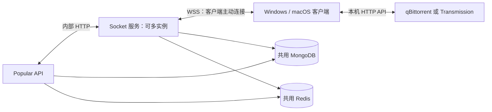
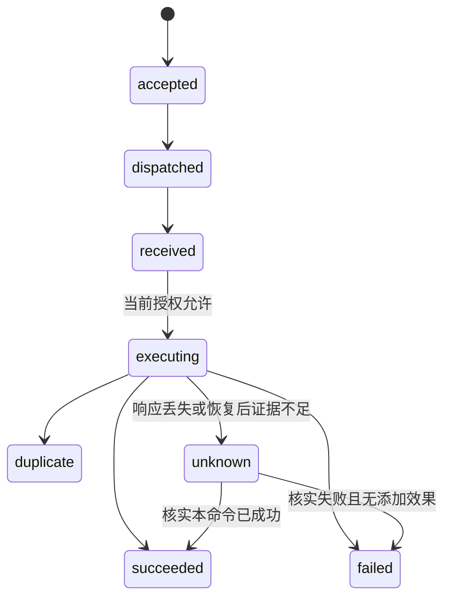

# Remote Client：本地下载客户端设计

> 2026-10-23：新增 Popular 主动状态查询及 7 天推送队列。新队列、状态时效和 Agent 接入要求以[交接契约](../apps/helpers/gateway/agent-queued-push-handoff.md)为准；原短期命令接口继续保留，新 Web 下载流程使用持久队列。

> 2026-10-21 Gateway 架构更新：本文的内部 HTTP、Gateway 直连 MongoDB 和共同写库方案已被替代。当前实现使用 Popular 主动建立的双向 WebSocket 连接池，所有 MongoDB 操作归 Popular，Gateway 只持有 Redis 租约与连接。当前服务契约以 [Gateway 集成文档](../apps/helpers/gateway/INTEGRATION.md)、[Agent 协议](../apps/helpers/gateway/PROTOCOL.md) 和 [验证范围](../apps/helpers/gateway/VALIDATION.md) 为准；下文保留为历史需求讨论。

更新日期：2026-10-21。

状态：需求与主要协议约束已确认，正式功能尚未实施。本文是实施依据，不代表这些接口、集合或生产能力已经存在。本次授权仅创建文档。

## 1. 目标与首版边界

让没有公网地址的用户，通过本机托盘客户端接收 Popular 下载命令，操作本机 qBittorrent 或 Transmission，并将平台创建任务的进度与结果同步回网站。

| 项目 | 已确认规则 |
| --- | --- |
| 操作系统 | Windows、macOS |
| 客户端形态 | 简单设置窗口；Windows 托盘图标、macOS 菜单栏小图标 |
| 启动方式 | 随用户登录自动启动，隐藏设置窗口，只显示图标 |
| 关闭窗口 | 后台继续运行；明确退出客户端才终止进程 |
| 下载器 | 同时只配置一个，qBittorrent、Transmission 二选一 |
| 下载目录 | 客户端不提供配置；添加任务时不指定目录，遵循下载器自身设置 |
| 免费额度 | 每个用户最多一个有效 `remote_client_api_key`，只能绑定一台设备 |
| 付费扩展 | 首版不实现；数据模型应允许以后扩展设备额度 |
| 全局产品上限 | 不设置全局在线设备总数或活跃下载任务数上限 |
| 在线前置检查 | 选择 Socket 链路时，Popular 在创建下载条目和提交命令前查询客户端在线状态；离线直接拒绝，不建立等待上线的下载队列 |
| 同步范围 | 只追踪 Popular 创建的任务；手动添加任务只可用于本机查重 |
| 状态上报 | 下载中每 30 秒一次；完成、暂停、失败等状态变化立即上报 |
| 语言 | 用户功能同时支持 `en-US`、`zh-CN` |

不设产品上限不等于容量无限。实现仍需限速、消息大小限制、发送缓冲限制、重连退避、心跳错峰和容量验证。

## 2. 架构与职责



| 组件 | 职责 |
| --- | --- |
| Popular | 用户权限、生成/重新颁发 API Key、展示和解绑设备、创建下载条目并提交任务、资源解析与种子 URL 获取、服务器直连下载器的 URL 添加、网站业务展示和通知 |
| Socket 服务 | 客户端身份验证、首次设备绑定、在线检查与连接接管、在线命令持久化、设备公钥加密与服务端命令签名、信封保存与投递、执行授权与结果核实、客户端回写验证及保存 |
| 本地客户端 | 本地凭据、设备私钥、本地执行记录、下载器配置、命令检测与执行、状态上报 |
| 下载器 | 通过种子 URL 获取种子，按其自身配置保存文件并执行下载 |

客户端不需要公网 IP 或端口映射，不直接访问 Redis、MongoDB。Popular 与 Socket 服务之间使用服务身份认证；用户设备 API Key 不作为服务间凭据。

图中展示生产链路：客户端访问服务端使用 HTTPS/WSS；本地开发测试可以显式配置 HTTP/WS。两种模式不自动相互降级，详细规则见第 4.5 节。

只绑定本机下载器的场景，应将控制接口限制在 loopback，并保留认证。电脑休眠、关机或下载器退出时不能执行；客户端恢复后自动重连。

## 3. 数据归属与多实例

两项服务共用基础设施。当前授权记录由 Popular 和 Socket 服务按明确操作共同维护：Popular 颁发和撤销，Socket 服务条件绑定与验证。不能为了单一写入方而强制所有设备操作经 Popular，也不能允许双方任意覆盖状态。内部 HTTP 清单见第 3.2 节，实际集合名称与索引仍待定。

| 逻辑数据 | 写入职责 | 说明 |
| --- | --- | --- |
| 同一份当前授权记录：Key 摘要、绑定状态、`authVersion`、设备 ID、公钥及撤销信息 | Popular 负责颁发/撤销；Socket 服务负责首次条件绑定 | MongoDB 中一份权威状态；双方按共同版本和原子条件更新，不各维护一份授权副本 |
| 统一下载业务记录 `movie_downloads` | Popular 创建记录并管理通知字段；Socket 服务验证后更新远程记录的任务关联、进度和状态字段 | 复用网站现有记录，不新增 `remote_client_downloads`，双方字段级条件更新，不整体覆盖 |
| 命令、投递、执行授权、客户端回执/执行证据 | Socket 服务 | 接收客户端数据时负责身份、归属、当前会话、授权版本、状态转换及重放/去重验证，再持久保存；最新远程任务状态写入统一下载记录 |
| 在线租约、设备到实例的路由、会话代次、实例唤醒 | Socket 服务 | Redis 中使用独立前缀与过期租约 |
| 本地接收、执行意图及结果日志 | 客户端 | 重启后恢复去重与核实，不能只放内存 |

活的 Socket 连接只存在于对应实例内存。Redis 存储设备、实例和当前会话的映射，不存储连接对象。登记、接管、续租和释放需原子校验会话身份；旧会话断开不能删除新会话租约。

Redis Pub/Sub 仅作实例唤醒信号，不能作为命令唯一存储。持久记录用于查询、去重、执行结果核实及业务状态修复，不代表可以在客户端上线后自动补执行未完成的旧添加请求。共用 Redis/MongoDB 仍共享容量与故障影响，独立连接服务不等于数据库故障隔离。

### 3.1 共享授权记录的操作边界（已确认）

| 操作 | 执行方 | 更新或验证约束 |
| --- | --- | --- |
| 生成/重新颁发 Key | Popular | 验证登录用户归属；只存 Key 摘要，重新颁发时原子撤销旧授权并递增版本 |
| 首次设备绑定 | Socket 服务 | 在同一份当前授权记录上原子检查 Key 有效、版本未变化、尚未绑定，再登记设备及公钥 |
| 展示设备 | Popular | 读取共享记录供已登录且有权限的用户查看，不把缓存展示当作执行授权依据 |
| 解绑设备 | Popular | 原子撤销 Key、解除当前绑定并递增 `authVersion`，保存公钥撤销信息 |
| 投递、执行授权、客户端结果及状态接收 | Socket 服务 | 校验当前权威授权、设备、当前会话及版本；客户端传入身份不能自行作为可信依据 |

对当前授权的更新使用明确的字段更新及条件匹配，不以过期快照整体覆盖记录。双方共用 schema、字段含义和版本规则；具体代码共享方式待定。撤销记录的保存需要与当前授权撤销一致，不能因服务端另行记录审计而延迟授权失效。

Popular 提交业务意图及管理操作，Socket 服务负责处理客户端协议、验证回写并维护执行事实。Popular 可将已验证结果转换为网站业务视图和通知，不将客户端原始上报绕过 Socket 服务直接入库。

### 3.2 内部 HTTP 接口清单（已确认）

统一前缀为 `/internal/v1/remote-client`，以下是设计契约，不表示路由已实现。HTTP 路径使用普通名称；Socket 协议消息仍采用双下划线命令名。原五类接口继续保留；新增的在线前置检查需要 Socket 服务提供查询能力，具体在线查询路径及响应 Schema 待落地时确定，不沿用旧的“离线也接受命令”语义。

| 方向 | 方法与相对路径 | 职责 |
| --- | --- | --- |
| Popular → Socket | `POST /commands` | 幂等持久接收下载命令 |
| Popular → Socket | `GET /commands/:commandId` | 查询命令、执行与核实状态及状态版本 |
| Popular → Socket | `POST /commands/:commandId/close` | 人工结束平台请求，保留外部执行事实 |
| Popular → Socket | `POST /authorization-changes` | 通知解绑或 Key 更新，促进旧连接关闭和队列清理 |
| Socket → Popular | `POST /deliveries/prepare` | 设备可执行时获取最新种子 URL 及必要来源元数据；加密、签名与信封持久化由 Socket 服务完成 |

所有接口使用独立服务凭据认证并传播 `correlationId`，不使用用户设备 Key 代替服务凭据。接收端仍验证命令、owner 和设备归属；来自受信任服务不意味着可以任意跨用户操作。服务凭据的具体机制、轮换及公共错误 Schema 尚待定。

不增加 Socket → Popular 的首次绑定接口，Socket 服务在共享授权记录上直接条件绑定。网站和通知可读取 Socket 服务已验证、持久保存的共享状态，不强制引入 HTTP 回写接口或复制全部进度。通知的持久认领、去重和消费恢复另行定稿。

### 3.3 在线检查、创建命令与提交去重（已确认）

选择 Socket 链路时，Popular 先请求 Socket 服务检查目标设备当前是否存在有效在线会话，并校验归属和绑定。Redis 中单独存在在线标记不足以保证客户端仍可通信，Socket 服务需结合持有连接的实例确认状态。查询不可用时不能假定在线，也不提交等待客户端上线的添加任务。

客户端不在线时直接拒绝，Popular 提示：

> 客户端不在线，无法添加下载任务，请先启动客户端。

英文提示表达同一含义：`The client is offline. Start the client before adding a download task.`

正常离线拒绝发生在创建下载条目及提交命令之前，不创建待执行下载记录。预检查与实际提交之间仍可能断线，因此 Socket 服务接受和投递时再次检查在线状态；若条目已经创建，确认尚未执行则将本次添加标记失败并展示原因，不保留离线待执行队列。可能已经执行但结果不明时保留 `unknown`，不能误报确定失败。

`POST /commands` 业务请求示例：

```json
{
  "command": "__add_download__",
  "commandId": "cmd_example",
  "downloadId": "download_example",
  "ownerId": "owner_example",
  "deviceId": "device_example",
  "authVersion": 3,
  "source": "hdarea",
  "resourceId": "123456"
}
```

Popular 先创建现有 `movie_downloads` 下载条目，取得其 `downloadId`，再持久保存固定 `commandId`、该下载条目的关联与提交意图。`downloadId` 是添加命令的必填关联字段，后续投递、执行和回执沿用；超时、进程重启或恢复补送不生成第二条命令或第二份下载条目。请求不包含种子 URL、本地下载器凭据或用户设备 Key。

Socket 服务检查当前授权及有效在线会话后持久保存命令。首次接收返回 `202 Accepted`，表示已接收本次在线添加请求，不等于下载器添加成功，也不允许等待未来上线后执行。原“离线排队、上线补执行、命令有效 7 天”规则取消，不再为添加命令设置该离线等待期限。投递和执行许可继续分别受 5 分钟及 30 秒期限约束。

```json
{
  "commandId": "cmd_example",
  "downloadId": "download_example",
  "status": "accepted",
  "createdAt": "2026-10-21T01:00:00Z"
}
```

同一 ID 与相同业务内容返回原命令当前状态，不覆盖记录、不重新授权、不延长投递或许可期限。已因断线结束的命令不能在同 ID 重试时重新执行。相同 ID 携带不同业务内容返回 `409`；幂等内容比较覆盖用户、`downloadId`、设备、授权版本、命令和资源身份，不将每次变化的诊断关联信息作为新业务操作。接收时验证下载条目存在、归属当前用户且资源身份匹配，不能借命令创建接口新建第二份远程下载条目。仍需验证调用者和记录归属，不能因命中 ID 就泄露其他用户的状态。

调用结果不明时使用相同 ID 有界重试或查询，避免把已经接受/可能执行的请求当作未执行。持久提交意图用于查明结果并修复下载条目，不用于设备未来上线时自动补发添加。即时重试耗尽后继续核实是否接受/执行；明确没有执行则结束本次添加，证据不足为 `unknown`，不能无限维持离线待提交状态。具体持久落盘结构待定。

### 3.4 准备种子 URL 与加密投递（已确认）

`POST /deliveries/prepare` 业务请求示例：

```json
{
  "commandId": "cmd_example",
  "downloadId": "download_example",
  "deliveryId": "delivery_example",
  "authVersion": 3
}
```

Popular 从共享命令、下载条目与当前授权记录解析可信的用户、资源及目标设备，重新检查资源访问权限和授权后获取最新种子 URL，通过内部 HTTP 返回给 Socket 服务；不再由 Popular 生成加密信封或签名。响应结构示例：

```json
{
  "commandId": "cmd_example",
  "downloadId": "download_example",
  "deliveryId": "delivery_example",
  "source": "hdarea",
  "resourceId": "123456",
  "torrentUrl": "https://tracker.example/download.php?id=123456&passkey=EXAMPLE",
  "urlExpiresAt": null
}
```

URL 为虚构示例。来源提供已知到期时间时填写 `urlExpiresAt`，未知时为 `null`，不推测来源保证；种子标识在来源能够提供时可作为可选元数据返回。生产内部 HTTP 的业务语义不改变，但传输必须有机密性与服务认证保护，例如 HTTPS 或受保护且可信的等效通道；本地开发测试可显式使用 HTTP，不将其视为生产传输保护。URL、passkey、令牌和原始响应不得进入访问日志、诊断日志或错误回执。Socket 服务现在属于种子 URL 的明文接触方，这是已确认的信任边界。

Socket 服务根据命令读取当前设备加密公钥及 Key ID，重新检查授权和期限，使用 HPKE 加密载荷，以自身服务端签名密钥签名，并持久保存权威投递信封后再通过 WSS 发送。客户端验证 Socket 服务的签名再解密。设备 Key 或 `remote_client_api_key` 不作为命令加密密码。

同一 `deliveryId` 一旦由 Socket 服务持久生成信封，后续重试直接复用原信封、原到期时间，不因重试再次请求 URL 或延长 5 分钟期限。并发准备同一投递时只能有一个权威信封，具体唯一约束及生成协调待实现前确定。持久信封尚未生成时，URL 准备调用仍可能超时或需恢复；该阶段的幂等/恢复由原投递身份约束，不能把一次 HTTP 超时当成允许第二次添加。相同投递 ID 的业务关联变化须拒绝，已生成的信封不能原地替换为新 URL。

已保存信封过期返回结构化原因 `DELIVERY_EXPIRED`；确认未执行时结束本次添加，不通过自动换投递 ID 无限续期，也不在之后上线时补执行。结果可能已产生时仍先核实，不能绕过 `unknown` 恢复规则。有效信封重试也不得绕过在线、命令和当前授权检查。

Popular 返回 URL 不表示允许执行。Socket 服务实际投递前仍检查当前授权，客户端随后还需申请 30 秒执行许可，防止准备期间发生解绑。

### 3.5 查询、人工结束与授权变化通知（已确认）

| 操作 | 契约 |
| --- | --- |
| 查询 | 返回持久状态与状态版本；不根据超时推断是否执行，检查用户归属 |
| 人工结束 | 携带固定 `operationId`；重复调用返回同一操作结果，终结请求但保留 `unknown`、已知结果与审计，不改写成确定失败 |
| 授权变化通知 | 携带固定 `eventId`、`ownerId` 和新的 `authVersion`；重复处理无副作用，乱序旧事件不得恢复旧版本 |

Popular 先原子撤销权威授权，再发送变化通知。通知失败可补送；解绑不等待通知送达才生效。Socket 服务收到通知后依据当前权威记录处理，而不是将事件中的旧快照覆盖回数据库。旧事件即使重送，也不能影响之后绑定的新设备。

人工结束的超时同样不能被当成成功或失败，应重试原操作或查询。结束动作与在途授权/结果之间的具体状态版本条件及迟到结果审计，仍遵循第 8.4 节待细化项。

### 3.6 超时与重试规则（已确认）

| 参数 | 首版约定 |
| --- | --- |
| 普通内部调用超时 | 每次尝试 5 秒 |
| 准备投递超时 | 每次尝试预算 30 秒，需协调上游来源调用预算，避免无界叠加 |
| 单轮即时尝试 | 最多 3 次，包含首次调用 |
| 即时退避 | 两次重试约等待 1 秒、2 秒，并加入随机延迟 |
| 后台恢复 | 创建请求仅查询/核实接受和执行结果，不离线补执行；人工结束与授权变化通知可持久补送；有效在线请求的准备恢复须继续检查在线状态、命令状态、投递及授权期限 |

上述请求预算不是命令、投递或执行授权有效期，也不保证调用方断开后服务端立刻取消处理。每次超时后仍按原操作身份恢复，不能假定未产生效果。

| 响应或故障 | 处理 |
| --- | --- |
| 超时、连接中断、`502/503/504` | 依接口持久幂等规则使用原 ID 有界重试；可能已生效 |
| `429` | 遵守 `Retry-After`，不立即密集重试 |
| `400/401/403` | 不自动盲重试，分别定位参数、服务认证或权限问题 |
| `409`、业务过期、授权撤销 | 按结构化错误码处理，不更换身份绕过冲突或继续执行 |
| 持久化结果不明、未分类服务端错误 | 保留操作身份，查询/核实；不得当成确定未执行 |

`POST` 的可重试性来自应用层持久幂等契约，不能仅因使用 HTTP 就宣称安全。持久待办与命令的保留/清理需保证恢复期内仍可识别旧操作，具体保留期限、后台退避上限和终止条件待定。调用完成、失败和每次重试均记录关联 ID、阶段、耗时及结果，且不泄露凭据或信封明文。

### 3.7 standalone 兼容与统一下载记录（已确认）

正式部署可能使用 standalone MongoDB，核心链路不得强制依赖多文档事务。单节点副本集与 standalone 是不同部署模式，不能因只有一台机器就假定事务可用；当前连接代码也不能证明生产拓扑。事务可作为支持它的部署上的优化，不能是核心正确性唯一前提。

命令内的当前执行、当前授权和人工结束信息优先在同一文档中用条件更新维护。跨命令、下载记录及授权记录的流程需设计持久恢复标记、幂等与版本条件，允许网站业务状态短暂延迟；恢复不能重复添加。授权撤销与执行登记仍有跨记录并发问题，必须另行给出兼容 standalone 的协调方案，不能用“读取过当前授权”或“已有唯一索引”冒充已经解决。

复用现有 `movie_downloads`，取消新增独立 `remote_client_downloads` 的提案。现有集合已保存用户、电影、资源、下载器、种子身份、状态、进度、速度及嵌入通知任务，避免再维护两份下载进度和完成事实。

| 数据 | 保存位置 | 语义 |
| --- | --- | --- |
| 下载业务记录及最新远程状态 | 现有 `movie_downloads` | 下载什么、进度、是否完成、通知处理 |
| 添加控制命令 | 规划的 `remote_client_commands` | 在线接收、投递、授权、执行证据与添加结果；不承载等待设备上线的队列 |
| 加密投递 | 规划的 `remote_client_deliveries` | 每次投递的权威信封和有效期 |

`movie_downloads` 需扩展连接方式、设备 ID、当前命令关联、本地下载器实例身份及状态版本，具体字段名和索引尚待定。`provider` 继续表示 qBittorrent/Transmission，不能用一个 `remote` 值取代下载器类型；连接方式单独区分服务器直连和远程客户端。

Popular 创建业务记录与提交意图，通过命令必填字段 `downloadId` 指向这条记录。Socket 服务验证客户端回写后，直接更新同一个 `movie_downloads` 条目的任务关联、进度和状态；Popular 管理通知字段。双方必须条件更新各自字段，避免旧快照覆盖另一方写入。原有记录和唯一约束不能未经评估整体替换，同一来源资源在直连/远程间的重复请求和迁移语义需明确。

网站现有查询会主动访问下载器同步状态，实现时必须按连接方式分流：远程记录读取客户端已上报数据，Popular 不直接连接用户本机下载器。通知 worker 也需按连接方式读取完成事实，不能以旧的直连查询失败覆盖远程状态；其写入应限制在必要的通知字段，避免陈旧进度回写。

首版不创建 `remote_client_operations`。HTTP 幂等、待提交/授权变化待通知和恢复标记按职责放在对应业务记录：命令提交意图放 `movie_downloads`，执行/人工结束幂等放命令记录，信封准备结果放投递记录，授权变化待通知版本放当前授权记录。客户端事件去重字段和保留方式仍需细化。下载进度同步和完成通知不通过通用操作集合搬运或复制状态，也不要求额外“完成事件交接”。

### 3.8 集合、撤销归档和保留期限（已确认）

| 数据 | 已确认落点 |
| --- | --- |
| 当前授权 | 独立 `remote_client_authorizations`，关联 `ownerId`，不放入 `users` |
| 添加命令 | 独立 `remote_client_commands` |
| 加密投递 | 独立 `remote_client_deliveries`，Socket 服务生成、持久保存 |
| 撤销历史 | 独立 `remote_client_authorization_history`，不包含明文 Key 或私钥 |
| 下载与通知 | 复用 `movie_downloads` 和现有嵌入通知任务；不建 `remote_client_downloads` 或 `remote_client_operations` |

撤销时在当前授权文档内原子递增版本、撤销当前授权并保存一份待归档快照；之后按 `ownerId + 被撤销的 authVersion` 幂等写入历史集合，确认后条件清除该快照。快照未归档时，下一次授权变更先完成归档，不覆盖旧快照；数据库不可用时返回可重试错误，不假报成功。当前撤销立即生效，不等待历史归档。

| 数据 | 保留规则 |
| --- | --- |
| 当前授权记录 | 不设置 TTL，持续保留 |
| 撤销历史 | 保留 90 天 |
| 加密信封 | 投递过期 24 小时后删除密文，保留投递 ID、关联和到期信息供去重与核实；元数据最终清理与关联恢复期协调 |
| 已终结命令及去重信息 | 终结后保留 90 天；关联下载仍在追踪时不删除 |
| `unknown` 命令 | 不自动清理；人工结束后按终结记录保留 |

离线排队的 7 天命令期限已取消，不能与记录保留期混用。投递及许可到期通过显式检查执行，TTL 只用于达到保留期限后的清理；删除去重记录后也必须拒绝超过恢复期限的旧请求，不能把旧命令当作新请求。过期请求识别的具体字段和时间校验仍需实现前定稿。

用户已明确首版不为低概率的“解绑与执行申请同时发生”增加专门跨记录协调机制；保留关键操作检查当前绑定及 `authVersion`，并接受在途执行窗口。这不是已经解决了竞争条件，不承诺跨记录强原子性。此前提出的三步授权裁决、额外协调版本方案未获采用，不纳入首版要求。

## 4. API Key、设备绑定与撤销

### 4.1 凭据与设备身份

Popular 生成高熵随机 `remote_client_api_key`，完整 Key 仅在颁发时展示，服务端只保存摘要。客户端本地安全保存 Key；设备公钥、Key 摘要、设备归属和状态可保存在服务端。

设备第一次运行生成两套独立密钥：签名密钥用于证明设备身份，加密密钥用于解密命令载荷。两套私钥均不上传；`remote_client_api_key` 只负责认证，不作为种子 URL 的加密密码。

三项应用层机制均已确认保留，其密钥职责为：

| 机制 | 私钥归属 | 公钥用途 |
| --- | --- | --- |
| 设备认证签名 | 客户端本地 | Socket 服务验证客户端持有已绑定设备私钥 |
| 种子 URL 加密 | 客户端本地 | Socket 服务用设备加密公钥加密，客户端用私钥解密 |
| 服务端命令签名 | Socket 服务 | 客户端通过可信获取的服务端公钥验证命令来源与完整性 |

共三套独立应用层密钥对，不能混用。设备数量限制由服务端绑定记录执行，签名证明私钥持有，不保证物理电脑无法克隆。HTTPS/WSS 的 TLS 证书属于另外的传输层配置，不计入上述三套密钥。

`ownerId` 必须从有效 Key 对应的服务端记录取得，不接受客户端自报身份。`deviceId` 由服务端绑定成功后颁发；MAC 地址、硬盘序列号不作为认证依据。

### 4.2 首次绑定

1. 客户端先按第 4.5 节获取服务端签名公钥，检查本地已有设备密钥；首次生成的两套设备密钥必须先持久保存成功，才通过生产 WSS（本地开发可用 WS）提交 API Key 和公钥材料。已有密钥则复用，不按每次连接重新生成；服务端校验 Key 后颁发短时、单次随机挑战。
2. 客户端使用签名私钥响应挑战，签名同时覆盖两套公钥、协议用途、服务端身份和凭证版本，防止公钥替换或跨场景重放。
3. Socket 服务验证挑战签名后，直接对共享的 MongoDB 当前授权记录执行条件绑定，不再通过内部 HTTP 请求 Popular 完成首次绑定。
4. Socket 服务原子检查 Key 有效、授权版本未变且尚未绑定，再保存公钥并由服务端颁发 `deviceId`。并发首次绑定仅一台成功；同一设备请求重试应返回原绑定结果，不能新建设备。与 Popular 解绑/重新颁发并发时，过期 Key 或版本的绑定必须失败，不能恢复旧授权。

挑战有效期已确认为 60 秒、只能使用一次；过期申请新挑战，不延长原挑战。挑战存储、消费原子性、签名编码及加密私钥持有证明仍属于实施前待完成细节。

后续认证必须使用已绑定签名公钥完成新挑战，不允许通过连接请求覆盖公钥。API Key 通过受保护认证头传递，不放入 URL、Redis key 或日志。

首次绑定流程中断时，客户端重试沿用原有两套密钥，重新申请有效挑战。服务端已经绑定但响应丢失时，只有验证有效 Key、当前绑定版本和原设备身份，且两套公钥均匹配，才返回原 `deviceId`；不能将所有“已绑定”响应当成新设备注册，也不能因响应超时自动替换公钥。客户端收到原 `deviceId` 后持久保存，后续连接恢复该身份。

本地设备密钥保存失败或无法确认保存结果时，不提交首次绑定请求；先查明本地存储结果，避免服务端绑定成功但本地没有可用私钥。

### 4.3 更换、丢失与重新颁发

正常更换设备必须先在 Popular 解绑当前设备。丢失设备时，用户登录 Popular 后可直接重新生成 Key，不依赖旧设备在线或确认。

本地重装、配置丢失或安全存储异常按实际保留的密钥处理，不以“同一台物理电脑”自动放行：

| 本地情况 | 恢复规则 |
| --- | --- |
| 两套设备密钥完整，仅 `deviceId` 丢失 | 使用有效 Key 完成原设备身份验证，并核对两套公钥匹配当前绑定后，恢复原 `deviceId`；不新建设备 |
| 任一设备私钥丢失或不可恢复 | 不允许自动生成新密钥覆盖旧绑定；提示用户到 Popular 解绑并重新绑定，设备丢失也可重新生成 Key 撤销旧绑定 |
| 安全存储暂时不可访问 | 先报告本地存储问题，不直接认定密钥已丢失，也不自动重置身份 |

身份信息恢复不等于执行记录恢复。本地执行日志丢失时，已知命令仍按第 8.3 节核实，不能因找回 `deviceId` 就假定未执行或自动重新添加。

Popular 原子递增 `authVersion`、撤销旧 Key、解除旧绑定；重新生成场景同时颁发新 Key。正常解绑后也使用新 Key 绑定新设备。旧公钥保留撤销记录，任何授权判断只接受当前有效绑定。

旧挑战、旧会话和旧授权均绑定旧版本，因而失去授权。Popular 完成权威记录更新后，通过内部 HTTP 或 Redis 通知 Socket 服务，使相关实例关闭旧连接、作废确定未执行的命令并处理待核实状态。通知渠道与持久补偿方式待定；通知不是撤销生效的唯一依据。

即使通知丢失或 Socket 实例重启，关键操作也必须依据共享的当前授权记录拒绝旧设备。命令下发、执行授权、结果和状态接收都检查当前绑定及 `authVersion`；无法确认时暂停操作，不能继续信任旧缓存。首版关键操作读取 MongoDB 权威记录，不依赖可能过期的本地缓存；心跳不要求每次读取 MongoDB。

批量更新命令状态可以需要恢复处理，但设备授权不能等到批量更新或通知完成才撤销。首版按第 3.8 节不增加专门跨记录撤销/执行协调；读取权威记录不等于检查与后续写入原子化，已经授出的执行许可及在途调用保留撤销窗口。仍须满足各文档内的条件更新、执行去重和持久恢复规则，不强制要求多文档事务，也不承诺绝对撤回。

撤销不能让已复制的私钥无法解密已有密文，也不能撤回已提交给下载器的任务。此方案识别密钥持有者，不绝对证明某台物理电脑；完整设备凭据克隆仍是边界。未绑定 Key 被盗后存在抢先绑定风险；首版采用首次认证自动绑定，没有额外网站审批步骤。

### 4.4 会话接管

同一绑定设备认证成功后，新会话接管旧会话；旧会话立即失去命令领取及有效结果/状态更新权限，并被关闭。实际网络连接允许短暂重叠，但跨实例只承认一个有效会话。

连接数不是首版付费额度。用户产品额度按绑定设备数管理，每个设备保持一个有效会话。

### 4.5 生产传输与首次获取服务端签名公钥（已确认）

| 环境 | HTTP 接口 | Socket 连接 | 规则 |
| --- | --- | --- | --- |
| 生产 | HTTPS | WSS | 使用正常证书和域名验证，不因证书或连接错误降级为 HTTP/WS |
| 本地开发测试 | 可显式使用 HTTP | 可显式使用 WS | 只作为明确开发配置；不能将本地测试例外带入生产 |

客户端从已配置 Socket 服务的固定公钥接口获取密钥，不需要用户手动复制。接口路径暂拟 `GET /client/v1/signing-keys`，这是面向客户端的接口，不属于第 3.2 节的服务间内部接口；具体路径可在实现时统一确定。

首次流程：

1. 客户端确定已配置的服务地址，生产先验证 HTTPS 证书与域名。
2. 通过认证头携带 `remote_client_api_key` 请求固定公钥接口，Socket 服务验证 Key 是否有效；首次尚未绑定设备也可完成此步骤，不依赖已有设备签名来获取第一个服务端公钥。
3. 服务端返回可验证命令的公钥列表、Key ID、算法和有效时间，不返回任何私钥。
4. 客户端按服务地址保存公钥缓存，后续按命令的 `serverSigningKeyId` 找到对应公钥验证，再解密命令载荷。

API Key 证明客户端有权获取公钥；生产的公钥来源信任建立在已验证的 HTTPS 服务身份上，API Key 本身不证明返回方身份。客户端不能接受命令临时提供的公钥或任意公钥下载地址作为信任来源。服务地址切换不能将原服务缓存的相同 Key ID 当作新服务的可信公钥。

建立连接时可刷新缓存；遇到未知 Key ID 时，只从已配置服务的固定接口有界刷新，不能无限请求。刷新失败且没有适用的有效缓存、签名不匹配、算法不允许或公钥不适用时，不执行命令，不关闭验证作为兜底。

服务端计划轮换时，先发布新公钥，再切换新私钥签名；旧公钥保留用于验证尚未过期的旧投递，过渡后停止接受。精确缓存期限、有效时间字段与轮换重叠时长仍待实现时确定；私钥泄露等紧急撤销不能照搬普通过渡期，也不能承诺缓存客户端立即获知撤销。

本地 HTTP/WS 无传输保密及可信证书身份保证，不能把 API Key 或公钥通过明文获取描述为生产级可信认证，也不采用 TOFU 替代生产证书验证。种子 URL 的应用层加密不会顺带保护明文 HTTP/WS 中的认证头。生产证书异常应明确失败，本地例外需要显式开发配置。

## 5. 本地设置与凭据

设置窗口提供下载器类型、本机接口地址、认证信息、连接测试以及自动启动开关。首次未配置时只显示图标，由用户主动打开设置。托盘菜单提供打开设置、状态查看和退出入口。

下载器密码、设备私钥及远程客户端 API Key 使用 macOS Keychain / Windows Credential Manager 等本地安全存储。不将本地下载器凭据上传服务端；非敏感偏好与执行日志单独存储。

更换下载器后，仍在线且尚未提交的有效请求使用新配置；已经因离线结束的请求不因更换下载器恢复执行。进入执行阶段后固定关联该次执行对应的下载器实例，结果未明时不能向新下载器重投。原任务继续保留原关联，无法查询时展示状态暂不可获取，不伪报完成或失败。

## 6. 统一 URL 添加、在线投递与加密

现有页面的服务器直连下载与新的远程客户端下载统一采用种子 URL 添加。这是已确认的目标行为；当前代码仍是 Popular 获取种子文件后上传，尚未实施切换。URL 来源逻辑在 Popular 复用：HDArea 按资源 ID 和 passkey 构造，M-Team 通过来源接口获取，不能假定所有来源都能直接拼接。

```text
服务器直连：
Popular 创建下载条目 → 获取种子 URL → 直接通过下载器 HTTP API 添加 URL

远程客户端：
Popular 先检查客户端在线 → 离线则直接拒绝，不创建条目或等待队列
    → 在线时创建下载条目并提交资源标识 → Socket 再检查在线及授权并持久接收
    → Socket 通过内部 HTTP 向 Popular 获取种子 URL
    → Socket 使用设备公钥加密、用自身服务端密钥签名并保存信封
    → WSS 下发 → 客户端验证签名、解密、保存并申请执行授权
    → 通过本机 HTTP API 向下载器添加 URL
```

远程添加必须客户端当前在线。命令保存来源、资源标识、目标设备与创建时间，通过在线及授权检查后在本次请求准备执行时获取最新地址，不提前为离线设备生成或缓存待执行 URL。Popular 不再负责远程载荷加密或命令签名。

两条链路都由下载器拉取种子文件，不再由 Popular 或客户端先获取种子文件再上传；客户端不提供上传兜底，也不采用 Popular 种子中转 URL。下载目录仍由下载器自己配置，调用不指定目录。远程生产使用 WSS，本地开发可显式配置 WS；内部 URL 传递遵循第 3.4 节的环境、机密性与服务认证要求。

| 来源 | 已知依据与限制 |
| --- | --- |
| M-Team | 当前实现使用站点 API Key 获取 URL，拉取 URL 时不附带该 Key 或 Cookie；跨 IP、有效期和本地下载器直拉尚未实测 |
| HDArea | 用户明确确认 passkey URL 可独立使用；本次未进行真实下载实测。URL 中的 passkey 仍属于敏感凭据 |

来源暂不可用时，只有确认未产生添加效果且请求仍在线有效，才进行既定的有界请求重试；资源删除、凭据失效和配置问题需明确回报。断线后不无限等待重新上线；确认未执行则结束添加，结果不明按 `unknown` 核实。已添加任务的状态恢复不属于重新添加，不受此规则阻止。

### 6.1 URL 添加的结果确认（已确认）

下载器接受 URL 不等于种子已成功解析并建立任务。真实过程可能在后续拉取时遇到网络故障、链接过期、跳转、登录页面或种子无效，需要确认实际下载器任务与错误状态后回报添加结果，不能仅凭 HTTP 成功或通用接受响应标记 `succeeded`。

切换为 URL 后，Popular 不再先读取种子字节进行文件校验或解析种子标识。来源没有提供标识时，须依赖添加响应或经过验证的任务标记建立关联；不能仅凭出现一个新任务、相同名字或相同种子就接管任务。重复检测和恢复中的证据不足继续按 `duplicate` / `unknown` 既定规则区分，不因 URL 拉取慢或 HTTP 超时盲目重复添加。

现有两种下载器适配器需改为接受 URL，并保留任务标记、查询和错误处理能力；具体真实返回、异步可见性和可靠关联方式仍需验收。这次统一不将现有服务器直连链路强制改为经过 Socket 服务：直连继续由 Popular 调用下载器，远程链路才经 Socket 和本地客户端。

## 7. `__add_download__` 消息草案

协议中的执行命令/控制消息名统一前后双下划线；状态值保留普通字符串。以下字段结构是已讨论的协议草案，需通过正式运行时 Schema、加密库互操作和错误处理验证，不是现有 API。

### 7.1 受保护命令头

```json
{
  "protocolVersion": 1,
  "command": "__add_download__",
  "commandId": "cmd_example",
  "downloadId": "download_example",
  "deliveryId": "delivery_example",
  "correlationId": "trace_example",
  "deviceId": "device_example",
  "authVersion": 3,
  "encryptionKeyId": "device_encryption_key_example",
  "serverSigningKeyId": "server_signing_key_example",
  "cryptoProfile": "hpke-v1",
  "createdAt": "2026-10-21T01:00:00Z",
  "issuedAt": "2026-10-21T01:00:00Z",
  "deliveryExpiresAt": "2026-10-21T01:05:00Z"
}
```

| 标识或期限 | 语义 |
| --- | --- |
| `commandId` | 平台一次下载命令的稳定身份，所有重投和恢复沿用 |
| `downloadId` | Popular 已创建的 `movie_downloads` 条目身份；添加命令必填，固定关联，Socket 服务据此更新同一条记录 |
| `deliveryId` | 本次加密投递身份；相同密文重发沿用；重新获取 URL 并加密时生成新值 |
| `executionId` | 客户端持久记录的执行身份，不因超时或重启随意更换 |
| `grantId` | 一份执行授权的身份；有效期内的同一申请重试返回原授权 |
| `eventId` | 接收/执行回执的身份，重报同一事件沿用，服务端据此去重 |
| 命令可执行条件 | 必须属于当前有效在线请求；无离线等待 7 天的业务期限，终结后不能因重连恢复执行 |
| 投递有效期 | 默认 5 分钟，不能晚于已知 URL 到期时间；在线请求已结束时即使尚未到期也不得执行 |
| 执行授权有效期 | 默认 30 秒、单次使用；不得越过投递到期时间，且命令仍有效 |

示例时间为 UTC，不表示任务实际创建时间。过期依据服务端权威时间判断；客户端时钟偏差处理需另行定稿，不能依赖用户可修改的本地时钟保障授权。

### 7.2 加密载荷

以下仅展示解密后的结构，示例 URL 和种子标识均为虚构占位值：

```json
{
  "source": "hdarea",
  "resourceId": "123456",
  "torrentUrl": "https://tracker.example/download.php?id=123456&passkey=EXAMPLE",
  "expectedInfoHashes": {
    "v1": "0123456789abcdef0123456789abcdef01234567"
  }
}
```

`expectedInfoHashes` 可选，来源可提供时用于查重和核实；不假设所有来源具备。已讨论 `v1` 的 40 位十六进制 SHA-1 标识，v2/hybrid 的字段和比较规则待定。不得仅凭出现一个新任务或相同种子就证明本命令添加成功。

下载器使用本地配置，载荷不包含下载器密码、目录或站点 Cookie。URL、重定向和来源必须受限制，防止加密的任意 URL 变成本地请求入口；完整来源及重定向策略待实现前确定。

### 7.3 线上信封

```json
{
  "protected": "base64url-of-original-header-json-bytes",
  "enc": "base64url-of-hpke-encapsulation",
  "ciphertext": "base64url-of-ciphertext-and-authentication-tag",
  "signature": "base64url-of-server-signature"
}
```

草案 `hpke-v1` 使用 X25519、HKDF-SHA256、AES-128-GCM 的 HPKE 组合。采用成熟库，每次重新加密使用独立上下文，不自行拼装密码算法。命令头原始 UTF-8 字节作为附加认证数据；接收端验证收到的原始字节，不重新序列化 JSON。

Socket 服务使用其独立的服务端签名密钥，签名以下完整字符串，字段使用统一 Base64URL 编码：

```text
popular-remote-command/v1.<protected>.<enc>.<ciphertext>
```

客户端按第 4.5 节通过生产 HTTPS（本地开发可显式使用 HTTP）获取并缓存 Socket 服务端签名公钥，不能接受消息自带公钥作为信任根。加密与签名均由 Socket 服务完成，不要求客户端验证 Popular 的独立命令签名。加密保护载荷机密性，签名证明来源；两者不替代授权检查、命令去重或有效期验证。公钥获取及环境规则已确认；服务端签名算法、缓存及轮换精确参数、Base64URL 细则及跨 Rust/Node 的测试向量仍需定稿。

## 8. 执行授权与幂等边界

### 8.1 申请与允许/拒绝

客户端验证命令、解密、校验并持久保存后，准备执行时先持久保存 `executionId`，再通过当前认证会话发送：

```json
{
  "command": "__request_execution__",
  "commandId": "cmd_example",
  "downloadId": "download_example",
  "deliveryId": "delivery_example",
  "executionId": "execution_example"
}
```

这是自动检查，不增加用户确认步骤。服务端校验当前设备、会话、`authVersion`、命令、投递期限和已有执行状态，再原子登记执行与授权。示例只展示请求核心字段，正式公共消息头仍需包含版本、关联与事件身份等约束；不能靠请求中的 `deviceId` 自证身份。

| 回复 | 行为 |
| --- | --- |
| `__execution_granted__` | 返回该次授权的 `grantId`、关联身份和到期时间；客户端持久记录执行意图后，才调用下载器 |
| `__execution_denied__` | 返回结构化原因，例如授权撤销、客户端离线、投递过期、命令终结、原执行待核实；按原因处理，不统一映射失败 |
| 超时、断线或无明确允许 | 不开始调用下载器，恢复后使用已有执行身份重新核实 |

30 秒限制的是开始调用下载器的时间，不要求添加流程或下载在 30 秒内完成。授权与当前会话绑定，新会话不得直接复用旧会话授权。

### 8.2 重复申请与结果不明

| 情况 | 处理 |
| --- | --- |
| 相同 `commandId`、相同 `executionId`、原授权有效 | 返回原授权/当前状态，不延长授权期限 |
| 相同命令、不同执行 ID | 检查原执行记录，不能直接允许第二次添加 |
| 命令已有确定结果 | 返回已有结果，不再次授权 |
| 授权已过期，能够确认尚未执行 | 仅当本次在线请求未结束、客户端仍在线且投递仍有效时允许重新申请；不延长投递期限，不恢复已经因离线结束的命令 |
| 原执行可能已开始或结果回报丢失 | 进入核实流程，禁止凭授权过期或更换执行 ID 再添加 |

服务端按 `commandId` 原子登记当前执行，避免并发授权。客户端执行日志须先于下载器调用持久化，结果确定后先落盘再回报，重启恢复后沿用记录。

**这不是跨服务与下载器的 exactly-once 保证。** 本地日志、服务端授权和外部调用之间仍有崩溃窗口；拿到授权不证明未执行，授权超时也不证明没有添加。

执行恢复原则已确认，见下文。授权的单次消费协议、与会话接管的原子边界，以及下载器响应与本地执行记录的关联证据仍需实施前细化。没有足够证据时保守进入 `unknown`，不能以自动恢复为由重新添加。

### 8.3 客户端持久执行阶段与失联恢复（已确认）

本节保留执行证据及结果恢复能力，不恢复离线排队：客户端重连后可重报已保存结果、核实 `unknown` 并恢复已添加任务的进度；已经因离线结束且尚未执行的添加请求不能自动继续，需用户重新发起。下述 `prepared` 的重新授权始终受第 8.2 节当前有效在线请求条件限制。

| 本地阶段 | 含义 |
| --- | --- |
| `prepared` | 已持久保存命令和 `executionId`，尚未进入下载器调用阶段 |
| `invocation_started` | 已持久记录调用意图，接下来可能调用下载器；不证明调用实际发生 |
| `result_recorded` | 已持久保存确定结果，可以在重连后重报 |

顺序必须是：

```text
持久保存 prepared
    → 获得执行授权
    → 持久保存 invocation_started
    → 调用下载器
    → 持久保存 result_recorded
    → 回报服务器
```

本地阶段是客户端恢复证据，不替代服务端命令状态。调用意图落盘失败时不调用下载器；不得先调用、再补记意图。若意图已经落盘但实际调用前崩溃，也必须按可能执行处理，不能假装能够精确区分该崩溃窗口。

客户端重新通过当前身份认证后，使用原 `executionId` 上报本地恢复证据：

| 恢复证据 | 处理 |
| --- | --- |
| `result_recorded` | 重报原确定结果，服务端幂等接收并验证允许的状态转换 |
| 仍为 `prepared` | 先停止并隔离旧执行流程、确保旧授权不再使用，再提供未执行证据；命令若已因离线终结则只修复状态、不执行；仅当前有效在线请求可在投递期限内申请新授权 |
| `invocation_started`，无确定结果 | 保留/进入 `unknown`，查询原下载器核实，禁止直接重新添加 |
| 本地记录丢失、损坏或相互矛盾 | 不能证明未执行，保留/进入 `unknown` |

服务端不能把某个时刻的 `prepared` 快照直接视为安全重试依据：上报后旧流程仍可能继续执行。旧流程停止的协调与会话代次隔离需要实现时明确，也不能声称能回收已经发出的本地 HTTP 请求。

下载器中存在相同种子，不证明是本命令创建；没有找到任务，也不证明从未创建，任务可能被用户删除、状态尚未可见或查询失败。仅在本地添加响应、可靠任务标记等证据足以关联本命令时恢复成功；不得因恢复核实接管手动任务。任务标记必须经两种下载器真实行为验证，不能假定其具备原子幂等能力。

解绑后的旧设备恢复上报不再接受；服务端保留授权已撤销与结果待核实的信息。恢复优先避免重复添加，接受少数实际未执行任务停在 `unknown` 的取舍。

### 8.4 Popular 人工结束入口（已确认）

自动核实证据不足时，Popular 展示结果不确定，且系统不会自动重复添加。中文文案语义为：

> 添加结果暂无法确认。请检查本地下载器，系统不会自动重复添加。

英文文案需表达同一含义，例如：`The add result could not be confirmed. Check your local downloader; the system will not automatically add the torrent again.`

Popular 提供“结束本次请求”入口，客户端不负责该业务提示。只有当前用户拥有的命令可被人工结束，重复结束须幂等。人工结束终结平台请求并阻止后续自动执行；保留原 `unknown` 结果、执行证据及人工结束审计，不能改写成确定失败、未下载或下载完成，也不停止、删除下载器中的任务。

请求终结与外部效果是否发生是不同事实。具体结束状态字段及迟到结果的审计/展示规则待细化，不将人工结束伪装成下载器确认。再次尝试是否提供专门入口及其交互尚未确认，不添加自动强制重试行为。

## 9. 命令状态机

命令只描述添加操作，下载进度另存为任务状态。添加成功不等于下载完成。

| 状态 | 含义 |
| --- | --- |
| `accepted` | 已确认在线并持久接收，准备本次即时投递；不等待离线设备上线 |
| `dispatched` | 已尝试投递，尚未确认客户端持久接收 |
| `received` | 客户端已持久接收，尚未调用下载器 |
| `executing` | 已进入可能产生外部添加效果的阶段 |
| `unknown` | 可能已经添加，结果不确定，需要核实 |
| `succeeded` | 已确认本命令添加成功，建立平台任务追踪 |
| `duplicate` | 确认是已有种子，结束本次请求，不关联现有任务 |
| `failed` | 明确未成功，且本次命令不再自动重试 |
| `expired` | 投递已过期且确认没有执行，本次添加结束 |
| `invalidated` | 授权撤销，且确认没有执行 |



图中省略恢复和终结分支：有效投递过期且确认未执行时转 `expired`，解绑/Key 作废且确认未执行时转 `invalidated`。接收后发现客户端断线且确认未执行时结束为 `failed`，提示客户端不可用；结果可能已经产生时转 `unknown`。只在命令和在线会话仍有效时允许有界重发同一密文，不重新排队等上线。

`unknown` 的人工结束遵循第 8.4 节：终结请求与添加结果分别表达，不新增“确定未执行”的虚假转换。

解绑、重置 Key 后，旧设备尚未执行的命令全部作废，不转给新设备。`executing` 或可能已执行的命令保留/进入 `unknown`，同时记录授权已撤销；不能伪报“确定没有下载”，旧设备后续上报也不再被接受。

## 10. 重复种子与回执

客户端添加前按可获得的种子标识检查；添加时下载器返回重复结果，也执行同一规则。仅凭相同文件名或电影 ID 不算相同种子。

确定重复时，命令进入 `duplicate`，Popular 展示：

> 下载器中已存在该种子，无法重复添加。

英文文案需表达同一含义，例如：`This torrent already exists in the downloader and cannot be added again.`

不询问是否继续，不关联、修改、删除或持续同步用户手动任务，不自动重试，不触发下载完成通知。客户端只检测与执行，提示由 Popular 负责。已删除且无历史记录的本地下载无法保证识别。

恢复时若上次执行结果不明，发现相同种子并不足以区分手动任务与本命令产生的任务；证据不足保留 `unknown`，不能套用普通重复分支，也不能据此接管手动任务。

接收确认使用 `__command_received__`；执行结果使用 `__command_result__`。结果草案：

```json
{
  "protocolVersion": 1,
  "command": "__command_result__",
  "commandId": "cmd_example",
  "downloadId": "download_example",
  "deliveryId": "delivery_example",
  "executionId": "execution_example",
  "eventId": "event_example",
  "deviceId": "device_example",
  "authVersion": 3,
  "outcome": "duplicate",
  "errorCode": "TORRENT_ALREADY_EXISTS",
  "occurredAt": "2026-10-21T01:00:10Z"
}
```

`outcome` 使用 `succeeded`、`duplicate`、`failed`、`unknown`。成功回执必须附带已核实的下载器任务标识和本地下载器实例身份，任务关联字段见第 11.1 节。服务端按事件 ID 去重，并检查状态转移和当前授权；从服务端持久命令解析可信的 `downloadId`，核对上报关联，不能仅凭客户端提供的下载条目 ID 决定写入目标。旧命令或旧执行的回执不能覆盖同一下载条目中新请求的状态。

回执使用结构化错误码，Popular 按 locale 展示文案。不回传种子 URL、密码、Cookie 或可能携带敏感地址的原始错误。

## 11. 下载状态与完成通知

只追踪本命令确认添加成功的任务，持久维护平台命令、执行、下载器实例与任务标识的对应关系。下载器重启、任务数字 ID 复用和客户端重启不能导致错误关联。

### 11.1 成功后的任务关联（已确认）

任务使用 `deviceId + downloader.instanceId + downloader.torrentHash` 定位，关联原 `downloadId`、`commandId` 和 `executionId`。成功结果示例：

```json
{
  "protocolVersion": 1,
  "command": "__command_result__",
  "commandId": "cmd_example",
  "downloadId": "download_example",
  "deliveryId": "delivery_example",
  "executionId": "execution_example",
  "eventId": "event_success_example",
  "deviceId": "device_example",
  "authVersion": 3,
  "outcome": "succeeded",
  "downloader": {
    "provider": "qbittorrent",
    "instanceId": "downloader_example",
    "torrentHash": "0123456789abcdef0123456789abcdef01234567"
  },
  "occurredAt": "2026-10-21T01:00:10Z"
}
```

成功必须建立在实际任务确认上，不能仅凭 URL 接受响应。示例种子标识为虚构 v1 值；v2/hybrid 的具体表示仍需适配验证。下载器数字任务 ID 可以辅助查询，但不作为唯一身份。

客户端先持久保存任务关联和确定结果再回报，Socket 服务校验后将相同关联写入 Popular 原下载条目。客户端重启后恢复原关联，后续进度不能自行切换到另一个种子、下载器实例或下载条目。

更换下载器类型或连接目标时生成新 `downloader.instanceId`，只修改密码等不改变目标身份的配置不应随意更换实例身份。旧任务保留原下载器实例关联，不因新配置接管其他任务。查询明确发现任务已删除时上报缺失；下载器不可访问时上报状态暂不可获取，两者不混同为下载失败，也不自动重新添加。

### 11.2 持久递增序号与旧更新拒绝（已确认）

每个已关联的平台任务维护独立的持久递增 `sequence`。客户端重启后继续原序号，不按每次进程启动或 WSS 重连归零。定时采集和即时状态变化共用同一任务序号分配，避免产生相同序号的不同更新。

每次新状态更新先持久保存序号及对应事件，再发送；重发同一条更新沿用原 `sequence`、`eventId` 与内容，不为网络重试生成新的状态事件。同一已建立任务关联的序号不因重新认证而重置；任务关联变化不能靠递增序号绕过服务端归属检查。

Socket 服务先验证当前设备、会话、授权、原命令/执行及下载器关联，再以“对应任务且新序号大于已应用序号”为条件，原子更新原 `movie_downloads` 的状态、进度及已应用序号。较小序号作为旧更新不应用；相同序号的同一事件幂等处理，相同序号但内容或事件身份不一致应拒绝并记录安全诊断，不能覆盖原状态。

不要求补齐断线期间每个历史序号，可接收更高序号的当前快照；不能因为旧消息迟到就回退已保存的新状态。序号控制更新先后，不表示进度百分比只能增加；合法新状态仍需遵守业务状态转换。序号分配、事件持久化和丢失后的安全恢复实现仍需验证，不得静默从零重新上报。

### 11.3 上报频率与现有通知集成（已确认）

| 项目 | 规则 |
| --- | --- |
| 采集内容 | 任务标识、状态、进度、下载/上传速度、已下载与总字节数、采集时间 |
| 普通更新 | 下载中每 30 秒上报一次 |
| 状态变化 | 完成、暂停、失败等立即上报 |
| 断线恢复 | 重连后立即同步当前状态，不补发每一条历史进度 |
| 网站离线展示 | 保留最后已知状态，展示设备离线及最后更新时间，不误报失败 |
| 本地删除 | 同步删除/缺失状态，不自动重新添加 |
| 完成通知 | Popular 通知 worker 从同一条 `movie_downloads` 记录读取已验证的完成事实，按现有通知计划处理，不依赖额外完成事件交接集合 |

Socket 服务负责验证客户端回写，包括当前设备/会话授权、命令与执行身份、任务归属、字段合法性、事件去重、状态转换及更新顺序。验证后按服务端保存的 `commandId → downloadId` 关联，条件更新 Popular 最初创建的同一个 `movie_downloads` 条目，匹配记录归属、连接方式、当前命令/执行和状态版本。客户端自报 `downloadId` 仅用于核对，不能覆盖服务端关联；不匹配的回写拒绝，不创建新条目绕过问题。

Popular 网站直接读取这条记录展示最新进度和状态；Popular 通知 worker 扫描同一记录，按现有通知计划发送完成消息。远程任务读取已上报的完成事实，不再主动连接用户本机下载器。Socket 服务不覆盖 Popular 管理的通知发送字段，通知 worker 也不能用旧进度快照覆盖 Socket 服务更新的状态。

完成通知采用现有定时扫描机制：Popular 通知 worker 每 5 秒扫描 MongoDB，按到期时间和租约认领 `movie_downloads` 中已有的通知意图与通知任务，不等待 Socket 服务发送完成事件。Socket 服务只需将验证后的下载状态写入原下载条目，无需额外调用 Popular 的完成通知接口；写入完成状态本身不会替代通知计划的登记。

接入远程任务时，通知意图恢复和正常通知处理两条路径都必须按连接方式分流：直连任务继续主动查询下载器，远程任务读取数据库中已验证的下载状态。确认完成后，worker 复用现有渠道发送消息并保存发送结果，失败按现有通知计划重试；远程分支只更新通知字段，不回写读取时的旧下载进度。每 5 秒是扫描间隔，不是消息必定在 5 秒内送达的保证，实际发送还受任务到期时间、认领、处理耗时和重试影响。

链路为：Popular 创建下载条目并提交带 `downloadId` 的命令 → Socket 服务验证客户端回写并更新原条目 → 网站读取原条目，通知 worker 按计划处理原条目。首版已确定不创建 `remote_client_operations`；幂等和恢复标记保存在对应业务记录中，下载状态及完成通知没有额外交接集合。

现有通知意图 `notificationIntent` 和通知任务 `notificationTask` 嵌入 `movie_downloads`，保存发送计划、认领租约、渠道发送结果和重试状态，不是远程命令或通用 HTTP 幂等日志。远程下载完成通知接入现有通知能力，不另造第二套完成通知任务。具体认领、恢复、计划登记及与状态版本协调方式待设计，防止重复上报造成重复通知；内部去重不等于外部消息绝对只送达一次。

## 12. 安全与诊断约束

| 方面 | 实施要求 |
| --- | --- |
| 日志 | 复用现有结构化日志与脱敏约束；原生 Rust 侧提供对应能力，不复制敏感载荷 |
| 关联 | API、内部 HTTP、Socket、客户端执行使用一致 `correlationId`，记录阶段、耗时、结果、命令/投递/执行 ID 和重试次数 |
| 开关 | 验证布尔配置 `VERBOSE=false`，所有详细追踪受其控制并遵守 `LOG_LEVEL`；关闭详细追踪不关闭错误日志 |
| 错误 | 保留原始堆栈与 cause 链并脱敏，指出失败阶段；不得用通用重试消息抹掉诊断 |
| 禁止记录 | API Key、设备私钥、下载器凭据、Cookie、passkey、种子 URL、认证头及原始敏感消息 |

HPKE 不负责消息顺序、防重放或授权撤销，这些由消息身份、状态机和当前有效授权完成。协议解析必须限制大小、字段、版本和算法白名单；未知版本与不允许算法失败关闭，不静默降级。

## 13. 实验状态与验收

Tauri 为已实现的验证路线。实验目录已于 2026-10-21 清理，完整历史证据保留于[实验验证归档](archive/remote-client-tauri-validation.md)。这些是 2026-10-20 的实验记录，不是正式功能当前已完成的证明。当前客户端代码位于 `apps/helpers/agent`，其验证范围见[客户端验证记录](../apps/helpers/agent/VALIDATION.md)。

| 验证范围 | 状态 |
| --- | --- |
| macOS 原生应用、关闭窗口后台连接、重连、单实例、中英文 | 实验已通过 |
| macOS 钥匙串存取与跨进程读取 | 实验已通过；重编译后曾出现一次约 30 秒延迟，系统原因未确认 |
| 自动启动开关注册/取消 | macOS 实验已通过；未注销验证自动启动 |
| Windows 原生构建、托盘、凭据存储与登录启动 | 未验证；用户当前没有 Windows 电脑 |
| 正式签名、公证、更新与密钥访问兼容性 | 未验证 |
| 正式 WSS、设备认证/撤销、Socket 加密/签名、执行队列、直连与远程统一 URL 添加、状态与通知 | 未实施、未端到端验证 |
| 容量与资源消耗 | 未压测；调试包体积不代表内存或正式发布体积 |

Windows CI 可以提供编译、自动测试和安装包构建证据，不能代替 Windows 原生交互验收。实验结束时进程与模拟服务已退出、自动启动已关闭、虚构凭据已删除；当前是否运行须实施时重新检查。

正式验收至少覆盖以下并发与恢复场景：

1. 非法身份拒绝、首次 HTTPS 公钥获取及无效 Key 拒绝、证书失败不降级、显式本地 HTTP/WS、未知 Key ID 刷新、服务地址缓存隔离、正常换钥，以及并发首次绑定、旧公钥替换拒绝、解绑/Key 重置与会话接管。
2. 客户端离线时在创建下载条目前拒绝、预检查后断线的二次校验、接收后断线且未执行时结束、上线不自动补执行旧请求，以及 5 分钟投递/30 秒授权期限不因重试延长。
3. 授权请求重试、同命令不同执行 ID、三个本地持久阶段的崩溃与恢复、结果丢失、日志损坏及保守 `unknown`；人工结束保留不确定事实，旧流程隔离完成前不得重新授权添加。
4. 两种下载器在直连/远程链路的 URL 添加、接受 URL 后真实任务确认、过期/错误 URL 与异步失败、手动重复任务不接管、更换下载器后的队列与旧任务归属，以及双语错误提示。
5. 30 秒状态上报、关键变化立即上报、乱序/重复事件、离线完成补报、通知去重和敏感日志检查。

## 14. 实施前仍需定稿

以下是技术细节的待办，不改变上面的已确认产品规则；本文不构成正式实现授权。

| 事项 | 需明确内容 |
| --- | --- |
| 服务契约与持久化 | 第 3.1–3.8 节已确认职责、接口、独立集合、不建 operations、保留期及 standalone 兼容；在线前置检查替代离线队列和 7 天命令期限，提交恢复不得变成上线补执行；仍需定稿在线查询路径、字段/索引、URL 准备恢复及并发信封生成、服务凭据、错误 Schema、过期旧请求识别及通知补偿 |
| 认证与密码协议 | 60 秒单次挑战、三套应用层密钥职责、Socket 加密/签名、生产 HTTPS/WSS、本地 HTTP/WS、API Key 获取公钥与缓存刷新/计划轮换原则已确认；仍需确定挑战消费、签名算法/编码、加密私钥持有证明、HPKE 互操作、客户端公钥接口最终路径、缓存与轮换精确参数 |
| 执行并发 | 第 8.3–8.4 节恢复与人工结束已确认；首版不增加专门跨记录解绑/执行协调，不采用三步裁决；仍需细化单次授权消费、会话接管、旧流程停止证据、人工结束字段及迟到结果处理 |
| 下载器与任务身份 | 两条链路统一 URL 添加及第 11.1 节设备/下载器实例/种子关联已确认；仍需验证 URL 接受与真实任务建立的差异、拉取失败/重复的返回、标识缺失/v2/hybrid，以及真实添加关联证据 |
| 同步与发布 | 第 11.2 节持久递增序号、重发沿用及旧更新拒绝已确认；仍需实现验证序号分配与丢失恢复、现有通知模块适配及去重、时钟偏差、双平台验收、签名/自动更新与容量 |

## 参考与现有实现位置

- [HPKE：RFC 9180](https://www.rfc-editor.org/rfc/rfc9180.html)：混合加密、AEAD 与协议需自行处理的重放等边界。
- [HTTP Message Signatures：RFC 9421](https://www.rfc-editor.org/rfc/rfc9421.html)：签名覆盖、随机挑战与防重放参考；不表示本 WebSocket 草案已经实现该 RFC。
- [MongoDB 单文档原子性](https://www.mongodb.com/docs/manual/core/write-operations-atomicity/)：条件更新依据，不能自动解决跨文档或外部下载器的一致性。
- [Transmission RPC](https://github.com/transmission/transmission/blob/main/docs/rpc-spec.md)、[qBittorrent Web API](https://github.com/qbittorrent/qBittorrent/wiki/WebUI-API-%28qBittorrent-5.0%29)：URL 添加能力与版本适配依据。
- [M-Team 客户端](../apps/api/src/infrastructure/mteam/client.ts)、[HDArea 适配器](../apps/api/src/infrastructure/hdarea/hdarea.adapter.ts)、[资源站点服务](../apps/api/src/modules/resource-sites/resource-site.service.ts)：当前来源处理代码。
- [下载服务](../apps/api/src/modules/downloads/movie-download.service.ts)、[qBittorrent 客户端](../apps/api/src/infrastructure/qbittorrent/client.ts)、[Transmission 客户端](../apps/api/src/infrastructure/transmission/client.ts)：当前实现仍走服务器获取种子文件后上传；不能作为远程客户端 URL 链路已完成的证明。
